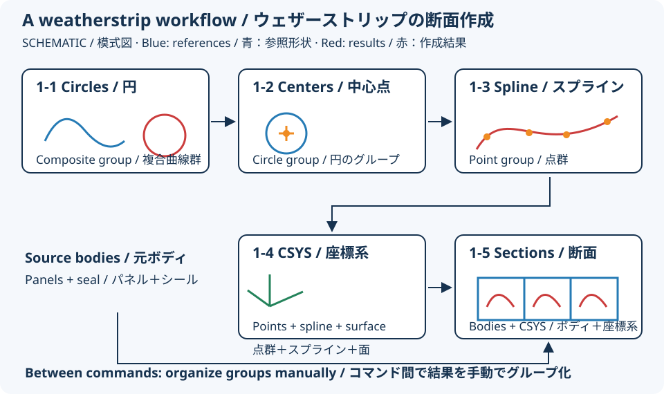
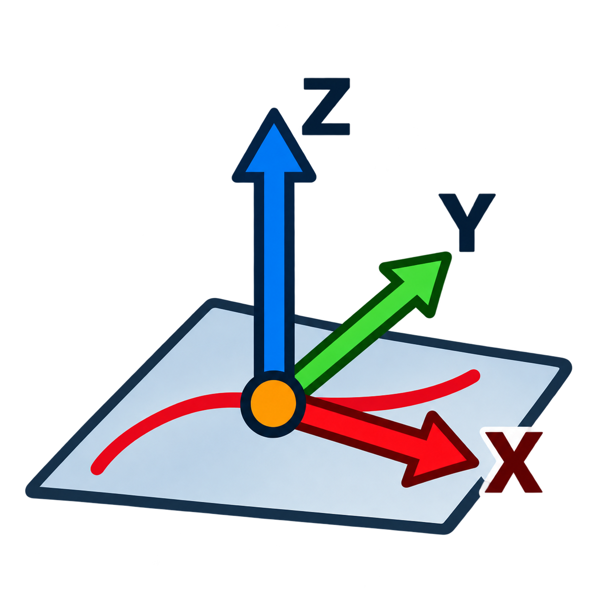
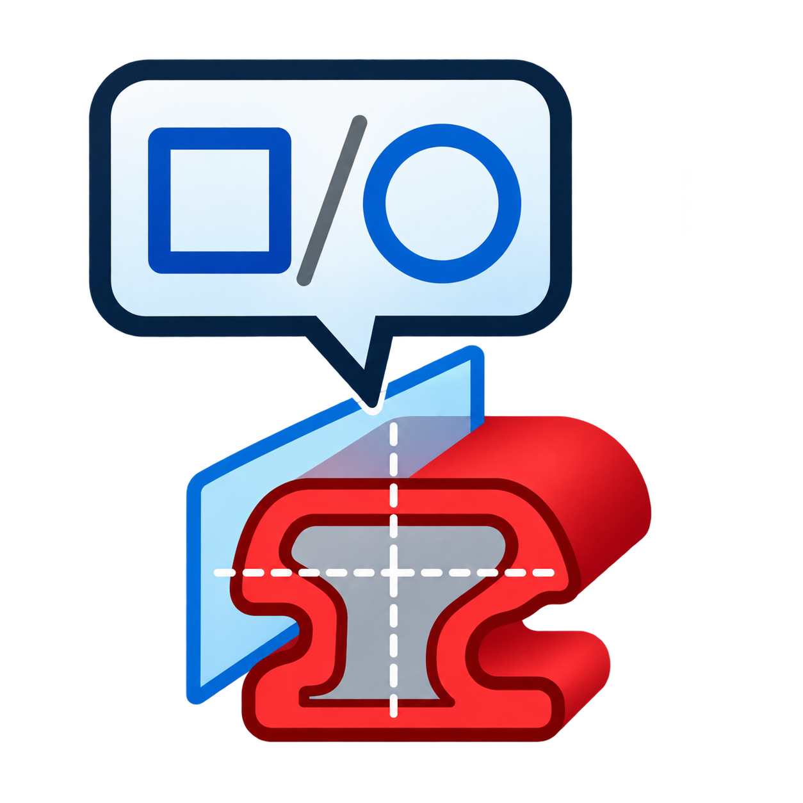

# NX Quality of Life

**From 3D references to repeatable seal-section drawings.**  
**3Dの参照形状から、繰り返し作成するシール断面図へ。**

[English](#english) · [日本語](#japanese) · [Installation / 導入](docs/INSTALLATION.md) · [Command guide / 操作ガイド](docs/COMMAND_GUIDE.md)

*Workflow illustration, not an NX screenshot. The commands do not automatically hand results to the next command.*  
*処理の模式図です。NXの実画面ではありません。次のコマンドへ結果を自動で受け渡す機能はありません。*

## English

Five Siemens NX Open journals help mechanical/design engineers turn composite curves into circles, centers, a reference spline, local coordinate systems, and arranged section views. They are **journal files played inside NX**, not a separately installed application.

### Start here

1. On [this repository](https://github.com/stefanoKS/NX_QualityOfLife), select **Code → Download ZIP** and extract it.
2. Keep the extracted folder in a stable location, for example `C:\NX_Tools\NX_QualityOfLife\`.
3. Open a suitable work part in **Modeling**. Follow the [input checklist](docs/COMMAND_GUIDE.md#preparation-en), then test one journal with **Tools → Journal → Play** (labels depend on release/role).
4. Follow the [illustrated installation guide](docs/INSTALLATION.md#english) to assign each `.vb` journal and its supplied `.bmp` to a ribbon button. **No compiling, Python, icon conversion, or Git knowledge is needed.**
5. Work through the [weatherstrip tutorial](docs/COMMAND_GUIDE.md#tutorial-en), organizing the output features into groups between commands.

### The five tools

| Icon | Tool | Result / guide |
|---|---|---|
|  | **1-1 Create Circles** | [Three associative samples per eligible Composite Curve → a full circle](docs/COMMAND_GUIDE.md#command-11-en) |
|  | **1-2 Arc Centers** | [Arcs/circles → associative center-point features](docs/COMMAND_GUIDE.md#command-12-en) |
|  | **1-3 Create Spline** | [Four or more ordered points → one open degree-3 spline](docs/COMMAND_GUIDE.md#command-13-en) |
|  | **1-4 Create CSYS** | [Points + spline + surface → associative Datum CSYS](docs/COMMAND_GUIDE.md#command-14-en) |
|  | **1-5 Batch Sections** | [Bodies + Datum CSYS → bounded intersection curves and 1:1 drawing views](docs/COMMAND_GUIDE.md#command-15-en) |

### Environment and verification

- **Windows + an existing Siemens NX installation with journal support** are required. The first four source headers target **NX 2306**; the fifth targets **NX 2406**. This is not a promise of compatibility across releases.
- Behavior in these guides was **verified against the current source**, not by running the journals in NX during this documentation work. Earlier experimental notes report NX 2406 compilation and some successful circular workflows; the current square, solid-body, update and display cases still need model-specific acceptance checks. See [compatibility](docs/INSTALLATION.md#requirements-en).
- 1-5 must start on the **displayed millimeter work part in Modeling**; it enters Drafting itself. It creates curves, **not** Boolean-cropped source bodies, automatic hatching, or DWG/DXF exports.
- [Testing/](Testing/) contains **optional experiments**, not installation requirements. The [separate refresh journal](docs/COMMAND_GUIDE.md#updates-en) is an optional troubleshooting tool, not a sixth mandatory command.
- All new illustrations are labeled schematics. See [real screenshots still needed](docs/assets/SCREENSHOTS_NEEDED.md).

## 日本語

Siemens NX Openの5つのジャーナルで、複合曲線から円、中心点、基準スプライン、局所座標系を作成し、断面ビューを図面に整列配置します。機械・設計エンジニア向けのツールです。**NX内で再生するジャーナルファイル**であり、別のアプリケーションをインストールする方式ではありません。

### はじめに

1. [このリポジトリ](https://github.com/stefanoKS/NX_QualityOfLife)で **Code → Download ZIP** を選び、ZIPを展開します。
2. 例：`C:\NX_Tools\NX_QualityOfLife\` のように、変更しない場所へ保存します。
3. **モデリング**で適切な作業パートを開きます。[入力の準備](docs/COMMAND_GUIDE.md#preparation-ja)を確認し、**ツール → ジャーナル → 再生**で1つのジャーナルをテストします（表示名はバージョン・ロールにより異なります）。
4. [図解付き導入ガイド](docs/INSTALLATION.md#japanese)に従い、各`.vb`と配布済みの`.bmp`をリボンボタンに登録します。**コンパイル、Python、アイコン変換、Gitの知識は不要です。**
5. [ウェザーストリップの操作例](docs/COMMAND_GUIDE.md#tutorial-ja)に沿って進め、各コマンドの実行後に結果のフィーチャをグループ化します。

### 5つのツール

| アイコン | 推奨ボタン名 | 結果・操作方法 |
|---|---|---|
|  | **1-1 Create Circles** | [対象の複合曲線から関連付けされた3点を求め、真円を作成](docs/COMMAND_GUIDE.md#command-11-ja) |
|  | **1-2 Arc Centers** | [円弧・円から関連付け中心点フィーチャを作成](docs/COMMAND_GUIDE.md#command-12-ja) |
|  | **1-3 Create Spline** | [順序付けされた4点以上から非閉鎖の3次スプラインを1本作成](docs/COMMAND_GUIDE.md#command-13-ja) |
|  | **1-4 Create CSYS** | [点＋スプライン＋面から関連付けデータム座標系を作成](docs/COMMAND_GUIDE.md#command-14-ja) |
|  | **1-5 Batch Sections** | [ボディ＋データム座標系から有界交線と1:1の図面ビューを作成](docs/COMMAND_GUIDE.md#command-15-ja) |

### 使用環境と検証状況

- **Windowsと、ジャーナルを実行できる既存のSiemens NX環境**が必要です。1-1〜1-4のソースには**NX 2306**、1-5には**NX 2406**の記載があります。全バージョンでの動作を保証するものではありません。
- このガイドは**現行ソースコードとの照合**に基づきます。今回の文書作成ではNX内でジャーナルを実行していません。過去の実験資料にはNX 2406でのコンパイルや円形範囲の一部の成功報告がありますが、現行の正方形範囲・ソリッド・更新・表示については、使用モデルでの受入確認が必要です。[互換性の説明](docs/INSTALLATION.md#requirements-ja)を参照してください。
- 1-5は**表示中のミリメートル単位の作業パートをモデリングで開いてから**実行します。その後、自動でドラフティングに移ります。作成対象は曲線であり、元ボディのブーリアン切取り、自動ハッチング、DWG/DXF自動出力は行いません。
- [Testing/](Testing/)は**任意の実験用ファイル**で、導入には不要です。[別の表示更新ジャーナル](docs/COMMAND_GUIDE.md#updates-ja)も、問題対処用の任意ツールであり、必須の6番目のコマンドではありません。
- 新しい図はすべて模式図と明記しています。[今後追加したい実画面](docs/assets/SCREENSHOTS_NEEDED.md)も参照してください。
