# Command guide / 操作ガイド

[Home / ホーム](../README.md) · [Installation / 導入](INSTALLATION.md) · [English preparation](#preparation-en) · [日本語の準備](#preparation-ja)

| Command / コマンド | English | 日本語 |
|---|---|---|
| 1-1 Circles / 円 | [Read](#command-11-en) | [読む](#command-11-ja) |
| 1-2 Centers / 中心点 | [Read](#command-12-en) | [読む](#command-12-ja) |
| 1-3 Spline / スプライン | [Read](#command-13-en) | [読む](#command-13-ja) |
| 1-4 CSYS / 座標系 | [Read](#command-14-en) | [読む](#command-14-ja) |
| 1-5 Batch sections / 断面一括作成 | [Read](#command-15-en) | [読む](#command-15-ja) |
| End-to-end weatherstrip tutorial / 一連の操作例 | [Read](#tutorial-en) | [読む](#tutorial-ja) |
| Update or regenerate? / 更新と再生成の違い | [Read](#updates-en) | [読む](#updates-ja) |

**Evidence / 根拠:** descriptions and defaults below were checked against the current five journals in [3D_to_Draft/](../3D_to_Draft/). Illustrations are original **schematics**, not NX screenshots or evidence of live execution. No journals were run in NX for this documentation.  
以下の動作・既定値は[3D_to_Draft/](../3D_to_Draft/)の現行5ファイルと照合しています。図は独自の**模式図**であり、NXの実画面・実行結果ではありません。今回の文書作成ではNX内でジャーナルを実行していません。

<a id="preparation-en"></a>
## Before any command — English

- Work on a saved **copy** of the intended work part. Begin in **Modeling**. 1-5 additionally requires the displayed part to be the same millimeter work part.
- Use **feature groups** in the Part Navigator, not assembly component groups, layer categories or merely selected screen objects. For 1-1 to 1-3 use **unique, nonblank group names**; names are matched without case sensitivity.
- For **1-1 to 1-4**, put the required features **directly** in the selected group. They do not recursively descend nested groups. **1-5** recursively reads nested groups and skips suppressed members.
- **Timestamp** means NX feature history order. It is not alphabetical name order, nearest-neighbor order or the order in which you click/group features. Confirm it against the Part Navigator's history order. If a feature yields several eligible entities, their internal order is the order returned by NX; it is not separately spatially sorted.
- The scripts **do not create the next input group**, replace previous results, or save the part automatically. Group outputs manually, and avoid accidental duplicate runs. Output numbering starts again on a new run; do not identify separate batches by names alone.
- Associativity means geometric parent references are retained. It does **not** mean all group memberships, selections, layer categories and drawing layouts are dynamically rebuilt after every edit. Recheck results after topology changes.
- Colors in the diagrams: **blue** reference geometry, **orange** selected/source points, **red** created/highlighted geometry, **green** directions, **gray** secondary geometry. These are explanatory colors, not colors assigned by the journals.

**Making a feature group:** select the actual source **feature rows** in the Part Navigator, use your release's feature-grouping operation, and give the group a meaningful name. If the operation is not exposed in your role, use NX Help to locate it. Expand the finished group to check its direct members before playing a journal. For a handoff, group the **new output features**, not just the original input group; selecting screen curves alone does not establish the required group.

<a id="preparation-ja"></a>
## 全コマンド共通の準備 — 日本語

- 対象の作業パートを保存し、その**コピー**で作業します。**モデリング**から開始します。1-5では表示パートと作業パートを一致させ、ミリメートル単位にします。
- パートナビゲータの**フィーチャグループ**を使用します。アセンブリのコンポーネントグループ、レイヤカテゴリ、画面上の一時選択とは異なります。1-1〜1-3のグループには**空欄でない一意の名前**が必要です。名前の照合では大文字・小文字を区別しません。
- **1-1〜1-4**では、必要なフィーチャをグループの**直下**に置きます。入れ子のグループは再帰的に展開しません。**1-5**は入れ子を展開し、抑制されたメンバーを除外します。
- **タイムスタンプ**はNXのフィーチャ履歴順です。名前順、最近傍順、クリック順、グループに入れた順ではありません。パートナビゲータを履歴順にして確認してください。1つのフィーチャから複数の対象要素が得られる場合、その内部順序はNXの返却順であり、別途空間順には整列しません。
- 次の入力グループの自動作成、前回結果の置換、パートの自動保存は行いません。結果を手動でグループ化し、重複実行を避けてください。再実行では連番が最初から始まるため、別の実行結果を名前だけで識別しないでください。
- 関連付けとは、親形状への参照を保持することです。グループのメンバー、選択対象、レイヤ分類、図面配置まで、編集のたびに自動で作り直すという意味ではありません。トポロジーが変わる編集後は結果を再確認してください。
- 図の色：**青**は参照形状、**オレンジ**は選択点・元の点、**赤**は作成・強調形状、**緑**は方向、**灰**は補助形状です。説明用であり、ジャーナルが割り当てる表示色ではありません。

**フィーチャグループの作成：** パートナビゲータで実際の元の**フィーチャ行**を選び、お使いの版のフィーチャグループ化操作で、用途が分かる名前のグループを作成します。現在のロールに操作が表示されなければ、NXヘルプで場所を確認してください。グループを展開し、直下のメンバーを確認してから再生します。次のコマンドへ進むときは、元の入力グループだけでなく、**新しく作成した出力フィーチャ**をグループ化します。画面上の曲線を選択しただけでは、必要なグループは作られません。

---

<a id="command-11-en"></a>
## 1-1 — Create Circles

[日本語](#command-11-ja) · [Command index](#command-guide--操作ガイド)

### 1. What does it do?

Creates **one associative full circle per eligible Composite Curve feature** in a selected named feature group. It selects the longest connected output component, requires it to be a nonbranching chain or loop, and initially samples it at approximately **1/3, 2/3 and 1 of total arc length**.

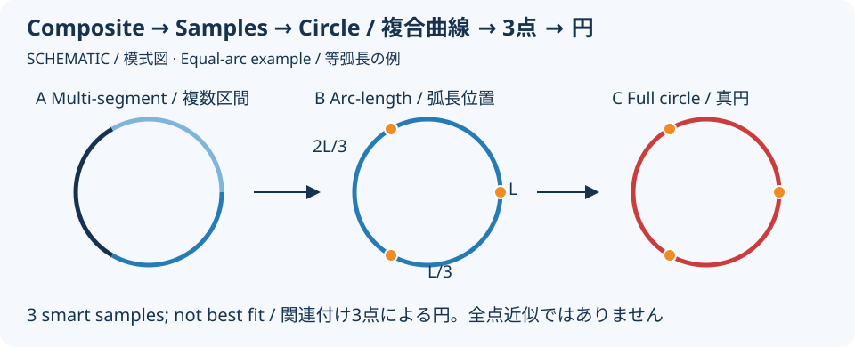

*The illustrated circular chain is an easy-to-read example. A general source need not itself be circular. / 図では分かりやすい円形の連続曲線を例示しています。入力が円形である必要はありません。*

### 2. Why is it useful?

Represents repeated clip-hole or sealing-reference boundaries with circles, so the following tool can extract their centers consistently. This is a **three-point circle**, not a least-squares/best-fit circle using all source points; assess whether that representation is suitable for your design intent.

### 3. Required input geometry

A named group with direct, unsuppressed **Composite Curve** features. Their output curves/edges must contain a usable nonbranching component with three noncoincident, noncollinear sample positions. Arbitrary curves merely placed together in a group are not a substitute for Composite Curve features.

### 4. Before-you-start checklist

- [ ] Correct work part open in Modeling; source features directly grouped.
- [ ] Group name is unique; source features are not suppressed.
- [ ] Gaps, branches and unwanted disconnected output have been checked.
- [ ] A three-point circle is the intended engineering representation.

### 5. Step-by-step usage

1. Run **1-1 Create Circles** or [play its journal](INSTALLATION.md#first-run-en).
2. Select the named input group from the editable dropdown, or type its exact existing name. Names are listed alphabetically; the first is the default.
3. Confirm **OK**. There are no size/radius inputs.
4. Read the completion summary and **Listing Window** for successes, skipped composites and excluded disconnected segments.
5. Inspect the results, then manually group the desired circle features for 1-2, for example `CLIP_CIRCLE`.

### 6. Example with realistic geometry

A door-seal reference model has twelve Composite Curve features, one per clip boundary. Put them in an example group `CLIP_COMPOSITES`. If all twelve have valid three-point samples, the result is twelve circles in ascending source-feature timestamp order.

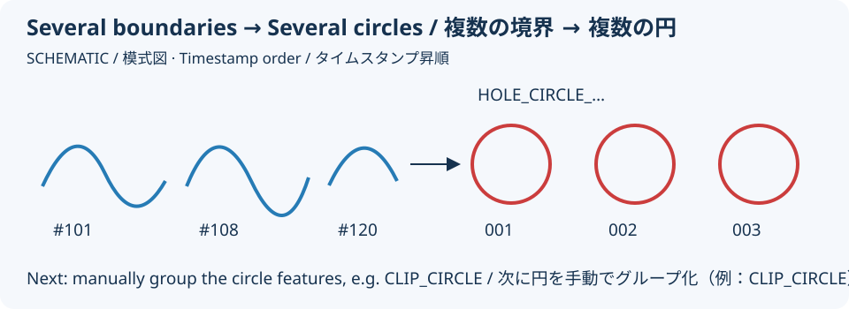

### 7. Result in NX

Successful results are named **`HOLE_CIRCLE_001`, `HOLE_CIRCLE_002`, …**. Numbering advances for successes, not failures. The samples are invisible associative smart points; **no intermediate point features** are added to the Part Navigator. The script checks that the result is a closed full circle rather than an open arc.

### 8. Associativity and update behavior

The circle references smart points on the selected source segments. At creation, their positions represent the three stated fractions of the chosen chain. **Chain selection and total-length fractions are resolved when the journal runs**: each smart point subsequently retains its local percent-arc-length reference to its selected segment. After unequal segment-length changes, do not assume all three points automatically redistribute to exactly 1/3, 2/3 and 1 of the newly combined length. Review or regenerate after segment/topology changes. This distinction is source-verified, not a live NX update test.

### 9. Common errors and solutions

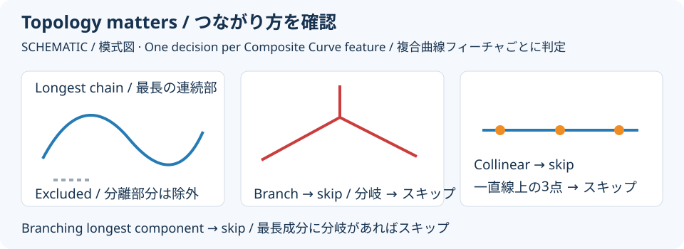

| Message/symptom | Action |
|---|---|
| No named groups / ambiguous name | Create a uniquely named feature group in the work part. |
| No eligible Composite Curves | Put active Composite Curve features directly in that group. |
| Branch at a junction | Repair the **longest connected component**. The script does not silently choose a shorter valid component instead. |
| Overlapping or nearly collinear samples | Inspect the chosen chain; a straight run or repeated positions cannot define a stable circle. |
| Some composites skipped | Read individual `SKIP` entries. A failed composite is rolled back individually; other circles may remain. Check Undo history if a rollback warning appears. |

### 10. Limitations

Shorter disconnected components are **excluded and reported**, not converted into extra circles. Endpoint connection tolerance is **0.01 mm** or **0.0004 inch**, according to part units; this is a connection test, not permission to repair arbitrary gaps. Traversal start/direction comes from the source output topology/order, not an interactive seam selector. No automatic output grouping or global best-fit calculation is provided. Source header: **NX 2306**; intended use: **Modeling**, with no demonstrated Drafting compatibility or release-wide certification.

### 11. Source journal

[1-1_CirclesFromCompositeGroups.vb](../3D_to_Draft/1-1_CirclesFromCompositeGroups.vb)

### 12. Before/after review

Compare the [sampling illustration](assets/11-chain-samples.svg) with your source. Check the full circle, parent references, excluded segments and number of successful features. Then continue to [1-2](#command-12-en).

<a id="command-11-ja"></a>
## 1-1 — 円の作成

[English](#command-11-en) · [コマンド一覧](#command-guide--操作ガイド)

### 1. 何をするコマンドか

名前付きフィーチャグループ内の、対象となる**複合曲線フィーチャごとに関連付けされた真円を1つ**作成します。出力の最長連結成分を選び、それが分岐のない連続曲線または閉ループであることを確認し、作成時の**全弧長のおよそ1/3、2/3、1**の位置にサンプル点を求めます。


*図は円形の連続曲線を使った例ですが、一般の入力が円形である必要はありません。 / A circular chain is illustrated; general inputs need not be circular.*

### 2. どのような場面で役立つか

繰り返し現れるクリップ穴やシールの基準境界を円で表し、次のコマンドで中心を取得しやすくします。全点を用いた最小二乗近似・ベストフィットではなく、**3点を通る円**です。設計意図に合う表現か確認してください。

### 3. 必要な入力形状

名前付きグループの直下にある、抑制されていない**複合曲線（Composite Curve）**が必要です。その出力曲線・エッジに、使用可能な分岐のない連結成分があり、重複せず一直線上でもない3点を取得できる必要があります。任意の曲線を同じグループへ入れただけでは、複合曲線フィーチャの代わりになりません。

### 4. 実行前チェック

- [ ] 正しい作業パートをモデリングで開き、元フィーチャを直下にグループ化した。
- [ ] グループ名が一意で、元フィーチャが抑制されていない。
- [ ] 隙間、分岐、不要な分離部分を確認した。
- [ ] 3点を通る円という表現が設計意図に適している。

### 5. 操作手順

1. **1-1 Create Circles**、または[ジャーナル再生](INSTALLATION.md#first-run-ja)で起動します。
2. 編集可能な一覧から入力グループを選ぶか、既存の正確な名前を入力します。一覧は名前順で、先頭が既定値です。
3. **OK**を押します。寸法・半径の入力はありません。
4. 終了メッセージと**情報ウィンドウ（Listing Window）**で、成功・スキップ・除外された分離区間を確認します。
5. 結果を確認し、1-2で使う円フィーチャを手動でグループ化します。例：`CLIP_CIRCLE`。

### 6. 実形状を想定した例

ドアシールの基準モデルに、クリップ境界ごとの複合曲線が12個あるとします。例のグループ`CLIP_COMPOSITES`へ入れ、12個すべてで有効な3点が得られれば、元フィーチャのタイムスタンプ昇順で12個の円を作成します。


### 7. NXでの結果

成功した円に**`HOLE_CIRCLE_001`、`HOLE_CIRCLE_002`、…**の名前が付きます。連番は成功した結果に対して進みます。サンプル点は関連付けされた非表示のスマート点であり、**中間の点フィーチャはパートナビゲータに追加しません**。開いた円弧ではなく、閉じた円が得られたこともコードで確認します。

### 8. 関連付けと更新

円は、選択された元の曲線区間上のスマート点を参照します。作成時には連続曲線の全弧長に対する3つの割合を求めます。ただし、**連続部分の選択と全弧長の割合の計算は実行時に行い**、各スマート点はその時に選ばれた区間内の弧長百分率を保持します。区間ごとの長さが異なる割合で変わった後に、新しい全弧長の厳密な1/3、2/3、1へ自動で再配分されるとは限りません。区間やトポロジーの変更後は確認・再生成してください。これはソースとの照合結果であり、NX内での更新試験ではありません。

### 9. よくあるエラーと対処


| 症状 | 対処 |
|---|---|
| 名前付きグループがない・名前が重複 | 作業パート内に一意の名前のフィーチャグループを作成します。 |
| 対象の複合曲線がない | 抑制されていない複合曲線をグループ直下へ入れます。 |
| 接続部に分岐がある | **最長の連結成分**を修正します。短い正常な成分で自動代用はしません。 |
| 3点が重なる・ほぼ一直線 | 選択された連続部分を確認します。直線や重複位置から安定した円は定義できません。 |
| 一部がスキップされた | `SKIP`の各行を確認します。失敗した複合曲線のみ取消しを試みるため、他の円は残る場合があります。取消し警告があれば元に戻す履歴も確認します。 |

### 10. 制約

短い分離成分は**除外して報告**し、別の円には変換しません。端点の接続許容差はパート単位に応じて**0.01 mm**または**0.0004 inch**です。これは接続判定であり、任意の隙間を修復する機能ではありません。始点・方向は元の出力順と接続関係から決まり、対話的に継ぎ目を指定する機能はありません。出力グループの自動作成・全点のベストフィットもありません。ソースには**NX 2306**と記載されています。**モデリング**での使用を想定し、ドラフティング対応や全バージョンの動作は確認していません。

### 11. ソースジャーナル

[1-1_CirclesFromCompositeGroups.vb](../3D_to_Draft/1-1_CirclesFromCompositeGroups.vb)

### 12. 作成前後の確認

[3点の取得図](assets/11-chain-samples.svg)と入力を比較し、円が一周していること、親との関連、除外区間、成功した数を確認します。その後[1-2](#command-12-ja)へ進みます。

---

<a id="command-12-en"></a>
## 1-2 — Arc Centers

[日本語](#command-12-ja) · [Command index](#command-guide--操作ガイド)

### 1. What does it do?

Creates an **associative center-point feature** from each NX arc/circle entity supplied by the direct members of a selected named feature group. It uses NX's arc-center reference, not a copied XYZ center.

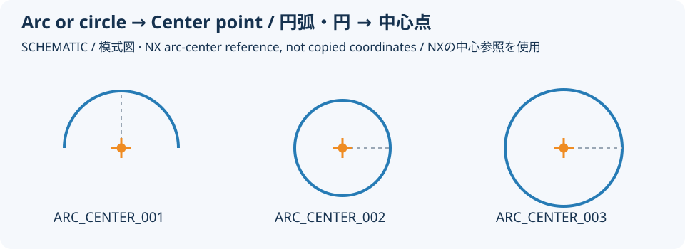

### 2. Why is it useful?

Turns repeated circular references into durable, editable point features for a sealing path or measurement stations. A partial arc gives its circle center, **not the midpoint along the arc**.

### 3. Required input geometry

A named group with direct, active features returning **NX arc geometry (`NXOpen.Arc`)**, including full circles. Ellipses, spline approximations of circles and sphere bodies are not accepted merely because NX also has a similarly named center-point tool.

### 4. Before-you-start checklist

- [ ] Unique group name; real arc/circle output directly in the group.
- [ ] Correct source-feature timestamp order.
- [ ] No prior test output you intend to replace accidentally.

### 5. Step-by-step usage

1. Run **1-2 Arc Centers**.
2. Select the group from the editable list, or type its existing name.
3. The preferred default is **`CLIP_CIRCLE`**, if present (case-insensitive); otherwise it is the alphabetically first named group.
4. Confirm **OK**. There are no dimension inputs.
5. Inspect the points, then manually create a point group for 1-3.

### 6. Example with realistic geometry

Place twelve clip-reference circles from 1-1 in `CLIP_CIRCLE` (example name, and a recognized preferred default). Twelve arc entities produce twelve center-point features. A source feature with several arcs can produce more than one point.

### 7. Result in NX

Visible points with real **Point features** named **`ARC_CENTER_001`, `ARC_CENTER_002`, …**. Parent features are processed by ascending timestamp; multiple arcs within one feature use NX's entity order.

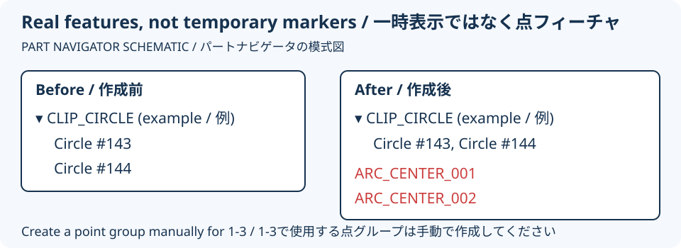

### 8. Associativity and update behavior

Each point references the actual parent arc center. Moving the source center should move the point on update; changing only the radius should leave its center in place. These are intended associative relationships derived from the source, **not newly verified live NX results**. Deleting/replacing parent topology may break references.

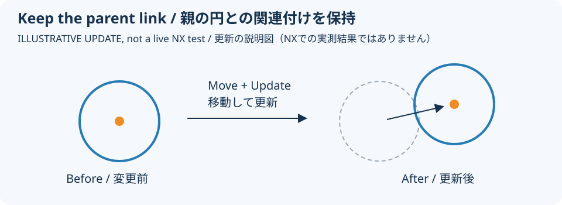

### 9. Common errors and solutions

| Symptom | Action |
|---|---|
| Empty/ambiguous group | Check the unique group name and direct contents. |
| No arc geometry | Check the entity type; a visually circular spline is not an NX Arc. |
| Creation failed | Inspect the error and Part Navigator/Undo history. The script attempts to undo the whole created series. |
| Points appear in an unexpected sequence | Check feature timestamps and multi-arc features; names/click order do not sort them. |

### 10. Limitations

No nested-group traversal, spatial sorting or automatic output group. Suppressed member features are skipped. A rerun creates another series rather than updating/replacing the previous one. There is no explicit millimeter-only check, but no cross-unit certification is implied. Source header: **NX 2306 / Windows**; use **Modeling**. Drafting execution has not been established.

### 11. Source journal

[1-2_ArcCenterPoints_Associative.vb](../3D_to_Draft/1-2_ArcCenterPoints_Associative.vb)

### 12. Before/after review

Use the [center diagram](assets/12-centers.svg) and [feature-list diagram](assets/12-navigator.svg) to check true centers and real point features. Group only the intended points, then continue to [1-3](#command-13-en).

<a id="command-12-ja"></a>
## 1-2 — 円弧・円の中心点

[English](#command-12-en) · [コマンド一覧](#command-guide--操作ガイド)

### 1. 何をするコマンドか

名前付きフィーチャグループ直下のメンバーが持つNXの円弧・円ごとに、**関連付けされた中心点フィーチャ**を作成します。中心のXYZ座標をコピーするのではなく、NXの円弧中心参照を使用します。


### 2. どのような場面で役立つか

繰り返し現れる円形の基準を、シール経路や測定位置に使用できる点フィーチャへ変換します。部分的な円弧の場合も、**円弧上の中点ではなく、その円の中心**を取得します。

### 3. 必要な入力形状

直下の有効なフィーチャが**NXの円弧形状（`NXOpen.Arc`）**を返す、名前付きグループが必要です。真円も対象です。NXの中心点ツールに似た名称があっても、楕円、円に似たスプライン、球ボディはこの処理の対象になりません。

### 4. 実行前チェック

- [ ] グループ名が一意で、実際の円弧・円を持つフィーチャを直下に入れた。
- [ ] 元フィーチャのタイムスタンプ順を確認した。
- [ ] 前回のテスト結果を誤って重複作成しない状態になっている。

### 5. 操作手順

1. **1-2 Arc Centers**を実行します。
2. 編集可能な一覧からグループを選ぶか、既存の名前を入力します。
3. **`CLIP_CIRCLE`**があれば大文字・小文字を区別せず既定値にします。なければ名前順の先頭です。
4. **OK**を押します。寸法入力はありません。
5. 点を確認し、1-3で使用する点グループを手動で作成します。

### 6. 実形状を想定した例

1-1で作成した12個のクリップ基準円を`CLIP_CIRCLE`へ入れます。この名前は例であり、優先既定値としても認識されます。円弧要素が12個なら中心点を12個作成します。1つの元フィーチャに複数の円弧がある場合は、複数の点が作成されます。

### 7. NXでの結果

表示された点と、**`ARC_CENTER_001`、`ARC_CENTER_002`、…**という実際の**点フィーチャ**を作成します。親フィーチャをタイムスタンプ昇順に処理し、同じフィーチャ内の複数円弧はNXの返却順で処理します。


### 8. 関連付けと更新

各点は元の円弧の中心を参照します。中心を移動すると更新時に点も追従する想定で、半径だけを変えても中心位置は変わりません。これはソースから読み取れる関連付けの意図であり、**今回NX内で実行確認した結果ではありません**。親形状の削除・置換によって参照が失われる場合があります。


### 9. よくあるエラーと対処

| 症状 | 対処 |
|---|---|
| グループが空・名前が重複 | 一意の名前と直下のメンバーを確認します。 |
| 円弧が見つからない | 要素の型を確認します。円のように見えるスプラインはNXの円弧ではありません。 |
| 点の作成に失敗 | エラー、パートナビゲータ、元に戻す履歴を確認します。作成した一連の点の取消しを試みます。 |
| 点の順序が想定と違う | タイムスタンプと、複数円弧を持つフィーチャを確認します。名前やクリック順では並べません。 |

### 10. 制約

入れ子の展開、空間順の整列、出力グループの自動作成はありません。抑制されたメンバーは除外します。再実行は前回結果を置換せず、新しい一連の点を作成します。ミリメートル限定チェックはありませんが、全単位での動作を保証するものではありません。ソースには**NX 2306 / Windows**と記載されています。**モデリング**で使用してください。ドラフティングからの実行は確認していません。

### 11. ソースジャーナル

[1-2_ArcCenterPoints_Associative.vb](../3D_to_Draft/1-2_ArcCenterPoints_Associative.vb)

### 12. 作成前後の確認

[中心点の図](assets/12-centers.svg)と[フィーチャ一覧の図](assets/12-navigator.svg)で、真の中心と点フィーチャの作成を確認します。必要な点のみをグループ化して[1-3](#command-13-ja)へ進みます。

---

<a id="command-13-en"></a>
## 1-3 — Create Spline

[日本語](#command-13-ja) · [Command index](#command-guide--操作ガイド)

### 1. What does it do?

Creates one **open, degree-3 Studio Spline through the source points** from a selected named feature group. The input points are interpolation points, not merely a control polygon that the curve need not touch.

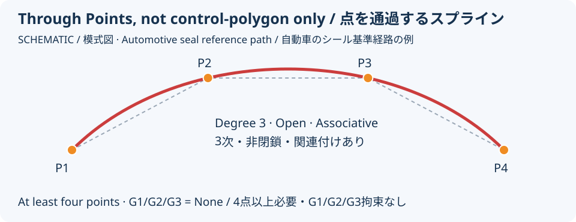

### 2. Why is it useful?

Produces a continuous reference path through clip centers along an automotive weatherstrip. Its tangents can define local section directions in 1-4.

### 3. Required input geometry

At least **four usable original NX Point objects**, returned by active direct member features of the selected group. Point features from 1-2 are suitable. The script does not create points by copying their current coordinates.

### 4. Before-you-start checklist

- [ ] Unique named point group with at least four points.
- [ ] Point features in intended **ascending timestamp** path order.
- [ ] Points are well-spaced and appropriate for one open path; no accidental duplicates.

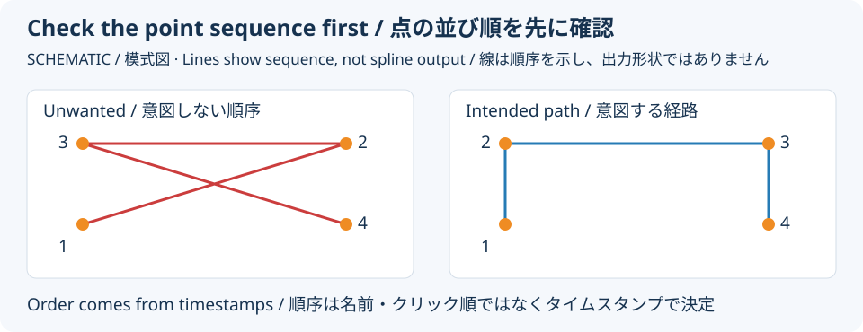

### 5. Step-by-step usage

1. Manually group the desired point features, for example `SEAL_POINTS`.
2. Run **1-3 Create Spline**.
3. Choose that existing group in the editable dropdown. The alphabetically first group is selected by default.
4. Confirm **OK**; there are no degree, closed-state or continuity input fields.
5. Inspect the complete path, especially its ends and any tightly spaced turns.

### 6. Example with realistic geometry

Twelve clip centers follow the upper and side portions of a door weatherstrip. Their point-feature timestamps run continuously along the intended open path. The result is one smooth reference spline through those centers. A complete closed door loop is **not** automatically made periodic/closed by this command.

### 7. Result in NX

One spline feature named **`SPLINE_<selected group name>`**, for example `SPLINE_SEAL_POINTS`. Fixed settings: **Through Points, degree 3, open/nonperiodic, associative; G1/G2/G3 constraints None; no plane constraint; match knots None**. Invisible zero-offset associative reference points are owned by the spline; **no extra visible control-point features** are added and the original point features are not modified.

### 8. Associativity and update behavior

The hidden reference points remain associated with the originals. Existing source-point movements can drive a spline update; topology changes may need repair. Adding or removing group members does not rerun the collection automatically. The image below illustrates the relationship; actual NX interpolation and update behavior must be checked on the model.

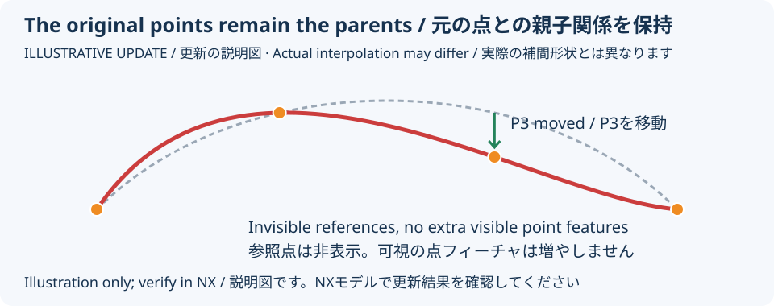

### 9. Common errors and solutions

| Symptom | Action |
|---|---|
| Fewer than four points | Group at least four usable point-bearing features directly; screen markers or nested groups do not count as direct points. |
| Unexpected zigzag | Inspect timestamp order. Renaming or clicking in a new order does not change it. Prepare/reorder source history carefully using normal NX tools and check dependencies, or recreate the source sequence. |
| Commit failed | Check coincident points, degenerate geometry and the NX message. The script attempts to roll back the spline operation. |

### 10. Limitations

No nearest-neighbor reordering, closed spline option, interactive endpoint continuity settings or automatic output group. “G1/G2/G3 None” means no additional such constraints, **not** that the resulting cubic path consists of straight segments. No explicit millimeter-only check. Source header: **NX 2306**; use **Modeling**; other releases/units and Drafting execution are not certified.

### 11. Source journal

[1-3_SplineThroughGroupPoints.vb](../3D_to_Draft/1-3_SplineThroughGroupPoints.vb)

### 12. Before/after review

Compare the [order](assets/13-order.svg) and [through-points](assets/13-through-points.svg) diagrams. Confirm all intended points lie on the spline and that its direction follows your intended section order. Continue to [1-4](#command-14-en).

<a id="command-13-ja"></a>
## 1-3 — スプラインの作成

[English](#command-13-en) · [コマンド一覧](#command-guide--操作ガイド)

### 1. 何をするコマンドか

名前付きフィーチャグループの元の点を通る、**非閉鎖の3次スタジオスプラインを1本**作成します。入力点は通過点です。曲線が通る必要のない制御多角形だけを指定する方式ではありません。


### 2. どのような場面で役立つか

自動車のウェザーストリップに沿うクリップ中心点を、連続する基準経路で結びます。その接線を1-4の局所断面方向に使用できます。

### 3. 必要な入力形状

選択グループ直下の、有効なメンバーフィーチャが返す**元のNX点オブジェクトが4点以上**必要です。1-2の点フィーチャを使用できます。現在座標のコピーから新しい点を作る方式ではありません。

### 4. 実行前チェック

- [ ] 一意の名前を持つグループに4点以上を入れた。
- [ ] 点フィーチャの**タイムスタンプ昇順**が意図する経路順になっている。
- [ ] 点間隔が適切で、1本の非閉鎖経路に使用でき、意図しない重複点がない。


### 5. 操作手順

1. 必要な点フィーチャを手動でグループ化します。例：`SEAL_POINTS`。
2. **1-3 Create Spline**を実行します。
3. 編集可能な一覧から既存のグループを選びます。既定値は名前順の先頭です。
4. **OK**を押します。次数・閉鎖状態・連続性を指定する入力欄はありません。
5. 端部と点が密集する曲がり部を含め、経路全体を確認します。

### 6. 実形状を想定した例

ドアのウェザーストリップの上辺と側辺に沿う12個のクリップ中心点を使用します。点フィーチャのタイムスタンプ順が経路に沿っていれば、中心点を通る滑らかな基準スプラインを1本作成します。ドア全周の点を使用しても、このコマンドが自動で周期・閉鎖スプラインにすることはありません。

### 7. NXでの結果

名前は**`SPLINE_<選択グループ名>`**です。例：`SPLINE_SEAL_POINTS`。固定設定は、**通過点・3次・非閉鎖／非周期・関連付けあり、G1/G2/G3拘束なし、平面拘束なし、ノット一致なし**です。元の点にゼロオフセットで関連付けた非表示の参照点をスプライン内部で使用します。**可視の制御点フィーチャは増やさず**、元の点フィーチャも変更しません。

### 8. 関連付けと更新

非表示の参照点は元の点との関連を保持します。既存の点の移動に応じてスプラインを更新できますが、トポロジー変更時は修復が必要な場合があります。グループの点を追加・削除しても、収集処理は自動で再実行しません。下図は関連付けの説明であり、実際の補間形状・更新結果はNXモデルで確認してください。


### 9. よくあるエラーと対処

| 症状 | 対処 |
|---|---|
| 4点に満たない | 点を持つフィーチャを4点分以上、グループの直下へ入れます。表示用マーカーや入れ子は直下の点として数えません。 |
| 経路がジグザグになる | タイムスタンプ順を確認します。名前変更やクリック順では変わりません。通常のNX操作で依存関係を確認しながら履歴順を整えるか、元の点の作成順を用意し直します。 |
| 作成を確定できない | 重複点・縮退形状とNXメッセージを確認します。スプライン作成処理の取消しを試みます。 |

### 10. 制約

最近傍順への自動整列、閉鎖オプション、端部連続性の対話設定、出力グループの自動作成はありません。「G1/G2/G3なし」は追加拘束がないという意味であり、曲線が直線列になるという意味ではありません。ミリメートル限定チェックはありません。ソースには**NX 2306**と記載されています。**モデリング**で使用し、他バージョン・単位・ドラフティングでの動作は保証していません。

### 11. ソースジャーナル

[1-3_SplineThroughGroupPoints.vb](../3D_to_Draft/1-3_SplineThroughGroupPoints.vb)

### 12. 作成前後の確認

[点の順序](assets/13-order.svg)と[通過点の図](assets/13-through-points.svg)を比較します。必要な点がスプライン上にあり、方向が意図する断面順に沿うか確認して[1-4](#command-14-ja)へ進みます。

---

<a id="command-14-en"></a>
## 1-4 — Create CSYS

[日本語](#command-14-ja) · [Command index](#command-guide--操作ガイド)

### 1. What does it do?

Creates **associative Datum CSYS features** from three inputs: **a point feature group, a spline, and a surface/body feature**. Each source point sets the origin; the nearest spline tangent sets Z; the nearest face normal supplies Y after orthogonalization.

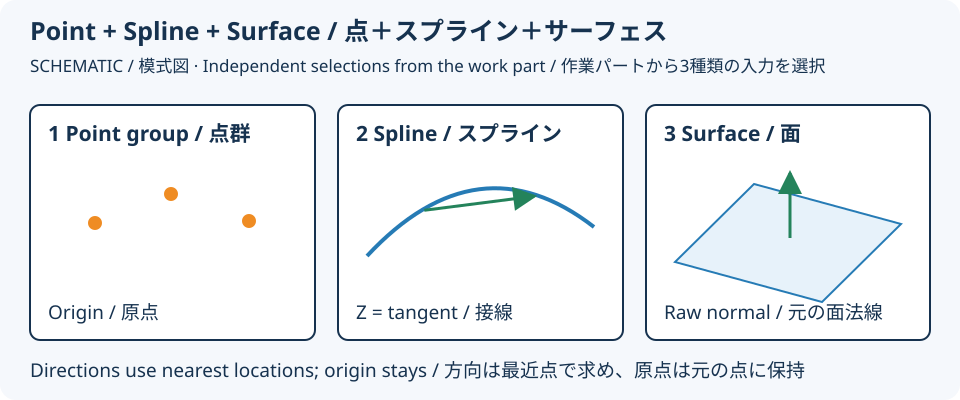

### 2. Why is it useful?

Provides repeatable section stations along a seal. With **Z along the seal path**, each local **XY plane** cuts across the path. Consistent X/Y orientation makes the later drawing views easier to compare.

### 3. Required input geometry

A group with direct point-bearing features, an actual **NX spline**, and a feature producing faces on sheet/solid bodies in the work part. One surface/body **feature** is selected, not an arbitrary set of individually clicked faces. A single point is sufficient for the initial test.

### 4. Before-you-start checklist

- [ ] Desired source points and spline exist; points are sensibly near the path.
- [ ] Selected surface/body feature has the intended nearest faces.
- [ ] Tangents and normals are independent, not nearly parallel.
- [ ] Leave **Test first point only** on for the first run.

### 5. Step-by-step usage

1. Run **1-4 Create CSYS**.
2. Select **Point feature group (origins)**.
3. Select **Spline (nearest tangent defines Z)**.
4. Select **Surface/body feature (nearest face normal defines Y)**.
5. Initially leave **Test first point only** checked (**default ON**). **Reverse Y** is unchecked by default.
6. Choose **Create CSYS** and inspect the first frame and Listing Window.
7. If Y faces the wrong way, undo the test and retry with **Reverse Y** checked.
8. Undo the test result before running all points, then uncheck **Test first point only** and run again. Manually group the final CSYS features for 1-5.

**Selection defaults:** first displayed point group (sorted by display text); latest-timestamp spline; first displayed surface/body feature, preferring a display name containing `SURFACE` if present. Always verify them—these are convenience defaults, not automatic design-intent recognition.

### 6. Example with realistic geometry

Select `SEAL_POINTS`, `SPLINE_SEAL_POINTS` and a panel reference-surface feature (all example names). Check a single frame on the upper door seal before creating the full array. Near a panel seam, the nearest-face choice can change abruptly, so inspect normal continuity.

### 7. Result in NX

**`SPLINE_CSYS_001`, `SPLINE_CSYS_002`, …**, in source point-feature timestamp order. Origin stays at the source point even if it is not exactly on the spline or surface. The actual nearest positions define the **directions**, not a replacement origin.

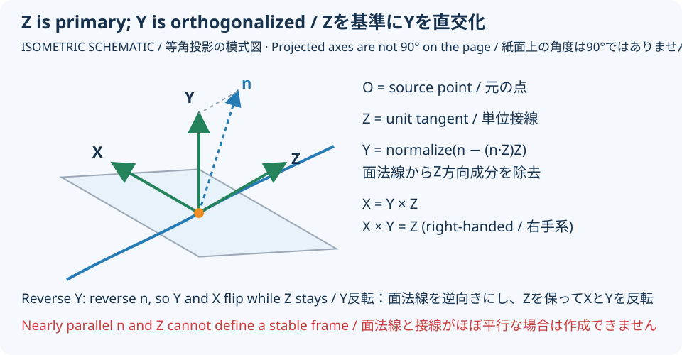

Let **Z** be the unit tangent and **n** the chosen face normal (reversed when requested):

- **Y = normalize(n − (n·Z)Z)**: remove n's component along Z, then normalize.
- **X = Y × Z**, hence **X × Y = Z**: a right-handed frame.
- Reversing n flips **Y and X**, not the primary Z tangent. If n is already perpendicular to Z, no projection-direction change is needed.

### 8. Associativity and update behavior

Smart directions, transform and Datum CSYS retain references to the original point, spline and selected feature's faces. Intended updates follow those parents; nearest-face changes can flip orientation, and topology edits can invalidate references. The diagrams explain the construction; verify translation, rotation and updates inside NX before relying on a full batch.

### 9. Common errors and solutions

| Symptom | Action |
|---|---|
| Missing geometry / empty selector | Check direct point group members, an NX spline entity and a feature actually producing faces. Suppressed/unusable candidates are omitted. |
| Near-parallel tangent and face normal | Choose a suitable reference surface/path or correct degenerate geometry. The code rejects a normalized absolute dot product above 0.999 (also checks zero vectors); Reverse Y does not cure parallelism. |
| Inconsistent Y senses | Inspect nearest-face normals along the whole path; test Reverse Y and check all frames. |
| Only one CSYS | Expected with the default test option. Undo it before the full run to avoid a duplicate first station. |
| Creation/update error | Read the failed stage in the Listing Window. The operation attempts a full rollback; verify Undo history if it reports rollback failure. |

### 10. Limitations

No nested point-group traversal, surface smoothing, manual nearest-face overrides or automatic CSYS output group. Point-group membership is collected once per run. Source header: **NX 2306**; use **Modeling**; other-release and Drafting support are not established. Do not equate an attractive axis display with correct section orientation.

### 11. Source journal

[1-4_CoordinateSystems_PointSplineSurface.vb](../3D_to_Draft/1-4_CoordinateSystems_PointSplineSurface.vb)

### 12. Before/after review

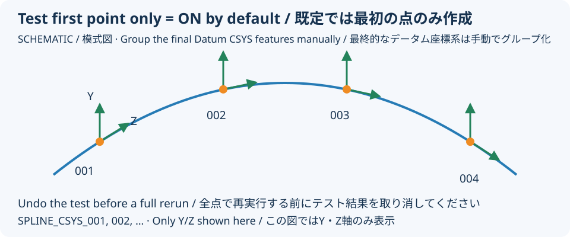

Compare the initial [inputs](assets/14-inputs.svg) with the array. Check **Z tangent, Y sense, right-handed axes**, and the local XY section plane at every station. Then manually group the Datum CSYS features and continue to [1-5](#command-15-en).

<a id="command-14-ja"></a>
## 1-4 — 座標系の作成

[English](#command-14-en) · [コマンド一覧](#command-guide--操作ガイド)

### 1. 何をするコマンドか

**点フィーチャグループ、スプライン、サーフェス／ボディのフィーチャ**という3種類の入力から、**関連付けデータム座標系**を作成します。各点を原点とし、スプラインの最近点の接線をZ軸、最近接面の法線を直交化した方向をY軸にします。


### 2. どのような場面で役立つか

シールに沿った断面位置を繰り返し定義できます。**Z軸をシール経路の接線方向**にすると、各座標系の**XY平面**が経路を横切る断面になります。X/Yの向きを揃えることで、後の図面ビューを比較しやすくなります。

### 3. 必要な入力形状

直下に点を持つフィーチャを含むグループ、実際の**NXスプライン**、作業パート内のシート／ソリッドボディに面を生成するフィーチャが必要です。個々の面を自由に組み合わせて選ぶのではなく、サーフェス／ボディの**フィーチャを1つ**選びます。初期テストは1点から実行できます。

### 4. 実行前チェック

- [ ] 必要な元の点とスプラインがあり、点が経路に対して適切な位置にある。
- [ ] 選んだ面フィーチャの最近接面が意図どおりである。
- [ ] 接線と法線がほぼ平行でなく、独立している。
- [ ] 最初は**最初の点のみテスト**を有効にしておく。

### 5. 操作手順

1. **1-4 Create CSYS**を実行します。
2. **原点となる点のフィーチャグループ**を選びます。
3. **最近点の接線をZ軸に使用するスプライン**を選びます。
4. **最近接面の法線からY軸を設定するサーフェス／ボディのフィーチャ**を選びます。
5. 最初は**Test first point only**を有効にします（**既定ON**）。**Reverse Y**は既定では無効です。
6. **Create CSYS／座標系を作成**を押し、最初の座標系と情報ウィンドウを確認します。
7. Yの向きが逆ならテストを取り消し、**Reverse Y**を有効にして試します。
8. 全点を処理する前にテスト結果を取り消し、**Test first point only**を無効にして実行します。最終的な座標系を1-5用に手動でグループ化します。

**選択の既定値：** 点グループは表示文字列順の先頭、スプラインは最新タイムスタンプ、面は表示順の先頭ですが、表示名に`SURFACE`があれば優先します。設計意図を自動判別するものではないため、必ず確認してください。

### 6. 実形状を想定した例

`SEAL_POINTS`、`SPLINE_SEAL_POINTS`、パネルの基準面フィーチャを選びます（すべて例の名前です）。ドア上部のシールで1つの座標系を確認してから全点へ展開します。パネルの継ぎ目では最近接面が急に切り替わる場合があるため、法線の連続性を確認します。

### 7. NXでの結果

点を持つ元フィーチャのタイムスタンプ順に、**`SPLINE_CSYS_001`、`SPLINE_CSYS_002`、…**を作成します。点がスプライン・面上に厳密に一致していなくても、原点は元の点に残ります。最近点で求めるのは**方向**であり、原点を移し替えるわけではありません。


単位接線を**Z**、選択した面の法線を**n**とします（反転指定時はnを逆向きにします）。

- **Y = normalize(n − (n·Z)Z)**：法線のZ方向成分を除去し、単位化します。
- **X = Y × Z**、したがって**X × Y = Z**となる右手座標系です。
- nを反転すると**YとXが反転**します。基準のZ接線は変わりません。nとZが既に直交していれば、投影による方向の変更は不要です。

### 8. 関連付けと更新

スマート方向、変換、データム座標系が、元の点・スプライン・選択フィーチャの面への参照を保持します。親形状への追従を意図していますが、最近接面の切替えで向きが反転したり、トポロジー変更で参照が無効になったりする場合があります。図は構成の説明です。全断面に使う前に、NX内で移動・回転・更新を確認してください。

### 9. よくあるエラーと対処

| 症状 | 対処 |
|---|---|
| 必要形状がない・一覧が空 | グループ直下の点、NXスプライン、面を生成するフィーチャを確認します。抑制・使用不可の候補は一覧に出ません。 |
| 接線と面法線がほぼ平行 | 適切な基準面・経路を選ぶか、縮退形状を修正します。コードは正規化した内積の絶対値が0.999を超える場合とゼロ方向を拒否します。Y反転だけでは平行状態は解消しません。 |
| Yの向きが揃わない | 経路全体の最近接面と法線を確認し、Y反転を試して全点を確認します。 |
| 座標系が1つだけ | 既定のテストモードでは正常です。最初の点を重複させないよう、取り消してから全点を実行します。 |
| 作成・更新エラー | 情報ウィンドウで失敗した段階を確認します。処理全体の取消しを試みますが、取消し失敗の表示があれば履歴も確認してください。 |

### 10. 制約

点グループの入れ子展開、面の平滑化、最近接面の手動指定、出力座標系グループの自動作成はありません。グループの点は実行時に一度収集します。ソースには**NX 2306**と記載されています。**モデリング**で使用し、他バージョン・ドラフティングでの動作は確認していません。見た目が整った軸表示だけで断面方向が正しいと判断しないでください。

### 11. ソースジャーナル

[1-4_CoordinateSystems_PointSplineSurface.vb](../3D_to_Draft/1-4_CoordinateSystems_PointSplineSurface.vb)

### 12. 作成前後の確認


最初の[入力図](assets/14-inputs.svg)と座標系列を比較します。各点で**Z接線、Yの向き、右手系の軸、局所XY断面**を確認します。データム座標系を手動でグループ化し、[1-5](#command-15-ja)へ進みます。

---

<a id="command-15-en"></a>
## 1-5 — Batch Sections

[日本語](#command-15-ja) · [Update guidance](#updates-en) · [Command index](#command-guide--操作ガイド)

### 1. What does it do?

Starting on the **displayed millimeter work part in Modeling**, creates a bounded square/circular **sheet in each Datum CSYS's XY plane**, intersects that sheet with the selected source-body faces, and then creates a new drawing sheet with arranged **1:1 base views** of the resulting model curves.

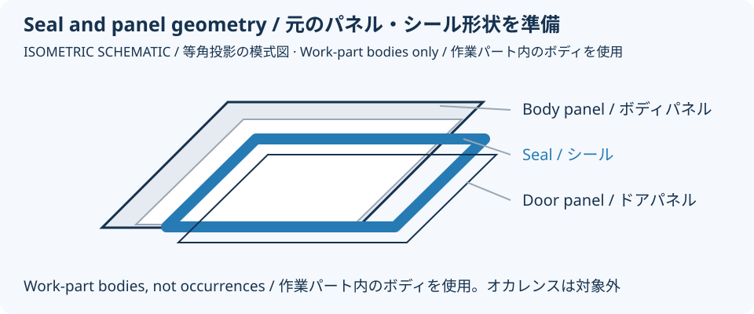

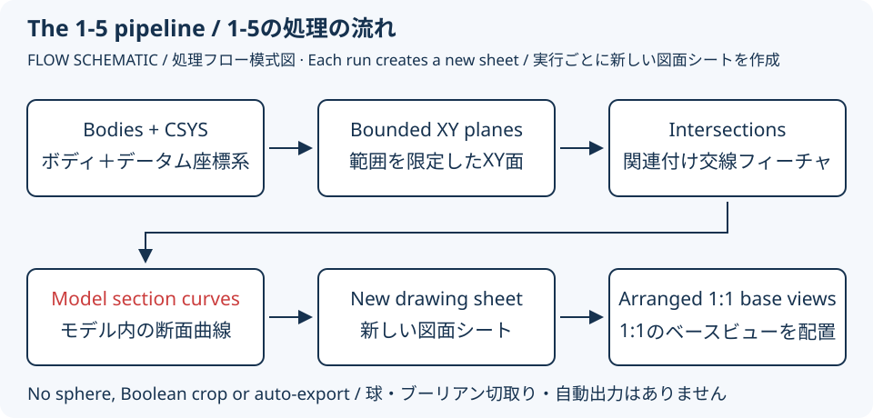

**Two different results:** the **intersection features/curves exist in the model**; the **drafting base views display those curves**. These are not automatically filled/hatched NX section views. The bounded sheet limits the actual intersection geometry, not just a viewport crop.

### 2. Why is it useful?

Automates repeated local seal/panel sections along a weatherstrip, using consistent station axes, ordering, scale and spacing. Source-layer categories remain separate while each drawing view isolates its own station.

### 3. Required input geometry

- **Source-body feature group:** active work-part **sheet and/or solid bodies** returned by its features. Nested groups are included. Multiple bodies per feature are inspected and duplicate references to the same body are removed; different overlapping bodies are not merged.
- **Datum CSYS feature group:** active **Datum CSYS features**, including nested members, with usable coordinate system, XY plane and X axis.
- **No assembly occurrence bodies:** the collection excludes them. Prepare suitable geometry in the work part with your normal approved NX workflow.
- The work part must be **millimeters** and must also be the **display part**. A usable **`Top` modeling view** is referenced by the implementation.

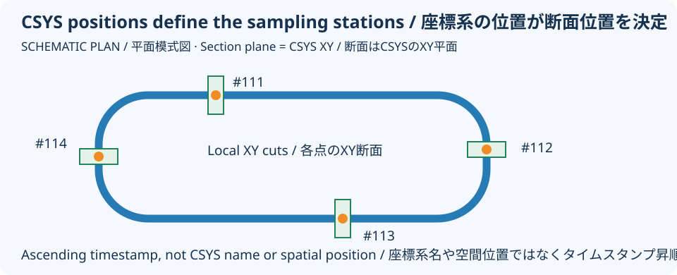

### 4. Before-you-start checklist

- [ ] Save a model copy and start in **Modeling**; confirm displayed part = work part and units = mm.
- [ ] Check the two groups contain the right bodies/Datum CSYS, with no unintended nested content.
- [ ] Assign **actual source bodies** to category layers if needed. Example: L1 body panel, L2 door panel, L3 seal. Separate layers are optional; one common layer is supported.
- [ ] Inspect each CSYS: **XY is the cutting plane**, X is drawing-horizontal and Y is drawing-up.
- [ ] Test one or two CSYS first; choose a window large enough to include the intended profiles.
- [ ] Check sheet capacity at 1:1. The very small square default is not a universal seal-section size.

### 5. Step-by-step usage

Run **1-5 Batch Sections**. The production file currently displays the title **“Disk Section Batch Test / 断面一括作成テスト”** and a v5.1 heading; this inherited wording is expected.

| Step | Input | Current default | Meaning |
|---|---|---|---|
| 1 | Source body feature group | First active group by timestamp | Choose the body group explicitly |
| 2 | CSYS feature group | First active group by timestamp | Choose the Datum CSYS group explicitly |
| 3 | Square / Circle | **Square** | One shape for the entire batch |
| 4a | Square size | **5 mm** | **Full side**, so local X/Y range is −2.5 to +2.5 mm |
| 4b | Circle size | **30 mm** | **Radius**, giving a 60 mm diameter; only asked in Circle mode |
| 5 | Drawing width | **5000 mm** | Custom sheet width |
| 6 | Drawing height | **5000 mm** | Custom sheet height |
| 7 | Gap | **10 mm** | Between cell envelopes and at sheet edges |

1. Select the **source-body group**, then the **CSYS group**. Group lists include timestamps; group names do not determine the processing order.
2. Select **Square** or **Circle**, then enter the appropriate size.
3. Enter drawing **width**, **height**, then **gap**. Enter numbers without `mm`; decimal parsing follows Windows regional settings. Sizes/drawing dimensions must be positive; gap may be zero. Cancel/blank stops the input sequence.
4. Allow the journal to create and check geometry. It switches to **Drafting**, creates and opens a **new custom metric, third-angle drawing sheet**, then arranges new views.
5. Inspect the completion message and Listing Window. Empty sectors leave empty grid slots; if **all** sectors are empty, the batch fails.
6. Perform the acceptance checklist below, then save the part explicitly.

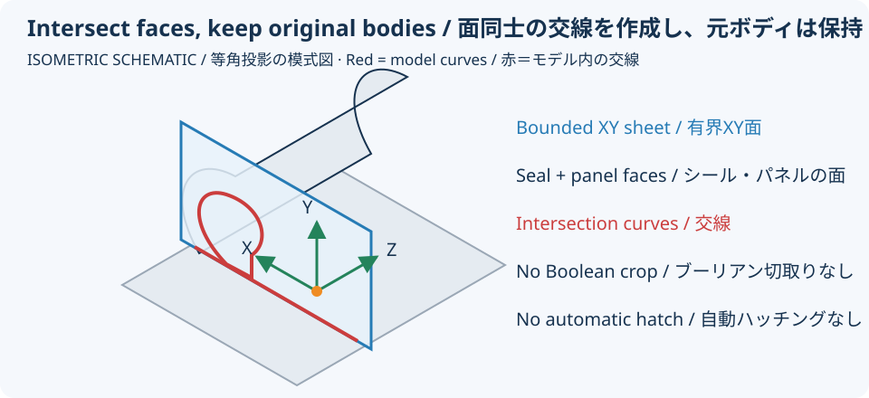

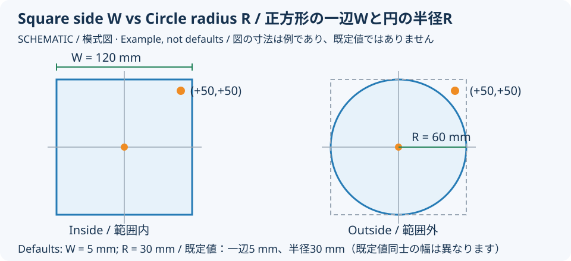

**Square side is not half-width; circle size is not diameter.** The diagram uses **W = 120 mm** and **R = 60 mm** for equal overall spans, **not the defaults**. Local `(50,50,0)` lies inside that square, but outside that circle because its distance is about 70.71 mm. Square edges follow the CSYS X/Y axes.

### 6. Example with realistic geometry

For an initial small weatherstrip sample:

| Parameter | Example value (not a default) |
|---|---|
| Source group | `SECTION_BODIES` containing body/door panels and a seal |
| CSYS group | `SECTION_CSYS`, initially two stations |
| Window | Circle, **radius 30 mm** (coincides with the circle default) |
| Sheet | **220 × 150 mm** |
| Gap | **10 mm** (coincides with the default) |

This sheet fits **three columns × two rows** of 60 mm envelopes. With two stations the journal uses two columns in one row. Expand to six stations only after the two-station comparison is satisfactory; then the layout matches the diagram below.

For a broader 30-station study, **square side 120 mm** or **circle radius 60 mm**, a **5000 × 5000 mm** sheet and **10 mm** gap are illustrative alternatives. That width fits all 30 stations **in one row**, not an automatically balanced multirow layout.

### 7. Result in NX

- Hidden, associative cutting construction: square edges **`SEAL_SQUARE_EDGE_1` … `_4`**, bounded sheet **`SEAL_SQUARE`**; or circle **`SEAL_DISK_BOUNDARY`** and bounded sheet **`SEAL_DISK`**. Construction names are reused across stations; do not assume globally unique names.
- A shared **NX size expression**, whose name is logged. Square means full side; circle means radius.
- Per-sector/per-source-layer intersection features named **`SEAL_DISK_SECTOR_001_L001`**, etc. **`DISK` remains in the feature name even for squares.**
- Generated curves receive the **numeric layer of their actual source body**. Several bodies sharing a layer are intersected as one category. The work layer and feature-group names do not supply the categories.
- New views named **`SECTOR_<CSYS timestamp>`**, with collision suffixes such as `_2` when necessary. Existing views are not renamed.
- Metadata records the batch ID, sector timestamp, source layer and boundary shape on intersections; views record batch/sector and display-mode information. Preserve this metadata if an optional refresh is required.
- Source bodies remain present, on their original layers, with their **global visibility unchanged**. Bodies are excluded **within each new view**; other sectors' curves and unrelated displayable objects on visible category layers are hidden by **view-dependent erasure**, not deleted.

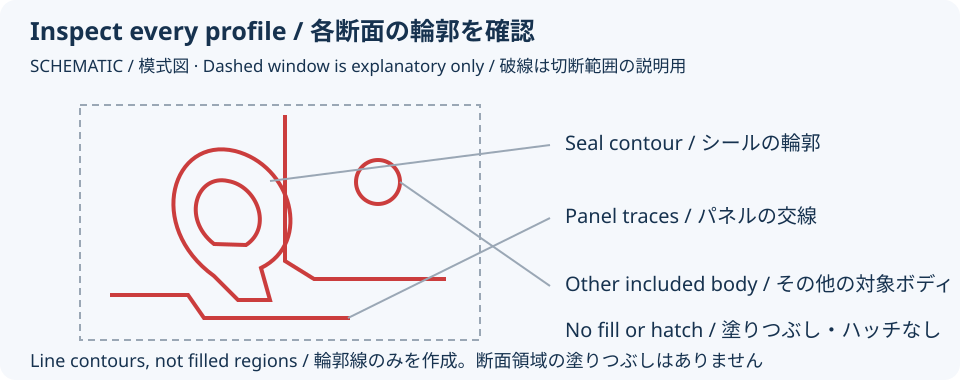

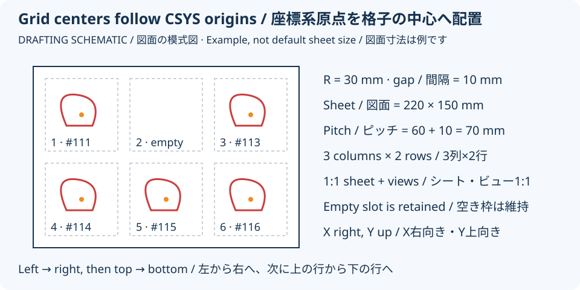

**Layout rule:** let `span = square side` or `2 × circle radius`; `pitch = span + gap`.

```text
columnsFit = floor((drawingWidth  - gap) / pitch)
rowsFit    = floor((drawingHeight - gap) / pitch)
columns    = min(columnsFit, number of selected CSYS)
```

Capacity must fit **all selected CSYS**, even ones that later produce no curves. Fill **left to right, then top to bottom**, in ascending CSYS timestamp order. In zero-based column/row coordinates, CSYS origins map to:

```text
X = gap + span/2 + column × pitch
Y = drawingHeight - gap - span/2 - row × pitch
```

The reserved size is the full window envelope, not the resulting curve's bounding box. Both sheet and view scales are **1:1**.

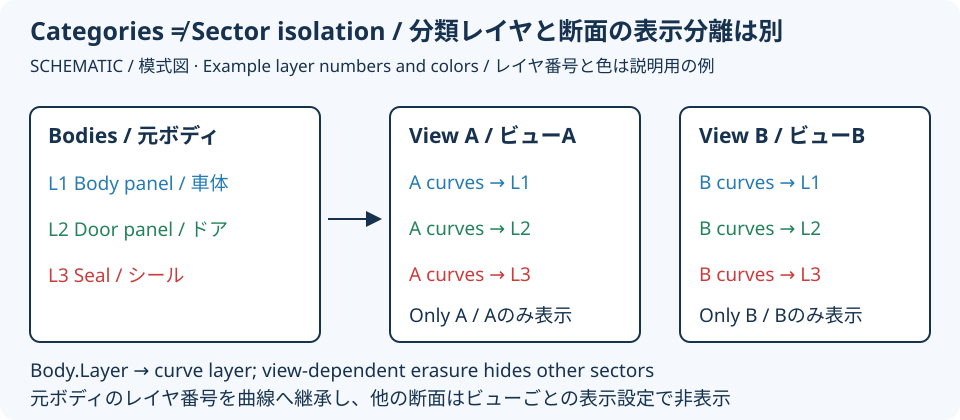

### 8. Associativity and update behavior

Smart construction points follow CSYS translation/rotation, boundary curves depend on the shared size expression, bounded planes depend on those curves, and intersections use associative **source-body face rules** plus the bounded sheet. Drafting orientation references the Datum CSYS XY plane and X axis.

These are geometric dependencies, **not a live layout engine**. Category-layer assignment, input membership, initially empty categories and grid placement are generation-time decisions. New curve entities after topology changes may need the **optional refresh** to restore recorded layers/isolation. Changes in source layers, membership, shape, size or layout may require **regeneration**, which creates another sheet rather than replacing the old one. See [the decision guide](#updates-en).

### 9. Common errors and solutions

| Symptom/error | Check / action |
|---|---|
| Open a millimeter part / display the work part | Start in Modeling with the same displayed/work part in mm. No unit conversion is performed. |
| No source bodies or Datum CSYS | Check group choice, suppression, nested members and occurrence bodies. A WCS alone is not a Datum CSYS feature. |
| Drawing too small | Increase dimensions or reduce window/gap; use the **side or diameter** in capacity calculations. |
| Wrong coverage | Check full side versus radius, CSYS origin/orientation and whether geometry lies outside the bounded face or only inside a solid volume without meeting any wall. |
| Boundary/feature warnings or intersection failure | Read the exact stage and NX error. The tolerance is **0.01 mm**. The journal checks its first boundary with temporary center-axis intersections (plus a square diagonal), then undoes the test geometry. Do not mask an error by assuming “outside”. |
| A category has no curves | A successful operation may return no curves. After an NX intersection exception, a category is skipped only if face-distance checks confirm every source face is separated by more than tolerance plus reported accuracy, with consistent points on the trimmed faces. Unresolved contact/query failures stop and attempt rollback, not silent omission. |
| Missing or mixed drafting curves | Compare against a manual section. The built-in visible-object check rejects unrelated returned model curves but **does not prove completeness**; NX may return drafting proxies. Use [refresh guidance](#updates-en) after inspecting geometry. |
| Batch failed partway through | The journal attempts to undo the batch and reports rollback errors. Check Part Navigator/Undo history; it does not promise to restore your prior application/sheet UI state. |
| Very long processing time | Start with fewer stations/bodies. Complex intersections and fallback per-face distance checks can be expensive; use the timing log rather than repeatedly restarting the full batch. |

**Optional timing diagnostics**

Every run attempts to write a unique UTF-8 `SealSection_<UTC time>_<suffix>.log` under:

```text
%LOCALAPPDATA%\NX_QualityOfLife\Logs
```

If unavailable, it tries `%TEMP%\NX_QualityOfLife\Logs`. The exact path or I/O warning appears in the Listing Window and final notice. Log I/O failures do not intentionally stop CAD processing. Look for:

- **RUN RESULT:** `SUCCESS`, `FAILED` or `CANCELLED`; an `END` row alone is not a success.
- **TIMING SUMMARY:** total and input-wait time; `self_s` excludes timed children, `inclusive_s` includes them. Do not sum overlapping parent/child “slowest call” rows.
- A last **START** without END: possibly a long-running/interrupted call, not proof of a hang. Forced termination can leave no summary. Fallback distance checks report progress every 100 faces.

Logs can contain model/group identifiers. Review them before sharing and follow your site's data policy.

### 10. Limitations

- This is **not** a sphere/Boolean crop, Extract Face, Split Body or original-body trim. It creates no sphere and does not modify the source bodies as a Boolean operation.
- Solid inputs produce **surface contours**, including inner walls where intersected—not filled material regions or automatic hatching. Sheet intersections can be open/disconnected. Coplanar overlap or difficult imported geometry may not produce a unique usable section.
- No automatic DWG/DXF export, alphabetic export-layer naming, DraftSight EntityGroups or export fidelity guarantee. Verify any downstream translation separately.
- Output sampling at **33 parameter positions per curve** is a sanity check, not a proof of complete coverage or entire-curve containment. First-boundary checks do not certify every source face.
- No automatic replacement of existing sheets, dynamic rescan of skipped categories, live category-layer synchronization or reflow of grid dimensions.
- Header target: **NX 2406**. Start in **Modeling**; the journal enters **Drafting** itself. Current square/solid/update/display behavior is source-verified here, **not live-verified on all geometry or NX releases**.

### 11. Source journal

Use [3D_to_Draft/1-5_Drafting.vb](../3D_to_Draft/1-5_Drafting.vb) for the production button, **not** the older sphere-based [Testing/SealSectionBatchTest.vb](../Testing/SealSectionBatchTest.vb). Experimental documents are historical context, not installation prerequisites.

### 12. Before/after review — acceptance checklist

Compare the [source assembly](assets/15-assembly.svg), [local cut](assets/15-plane.svg), [profiles](assets/15-profiles.svg) and [grid](assets/15-grid.svg).

- [ ] **Alignment:** each cut is the correct CSYS XY plane; X/Y senses and the origin position agree with a manual check.
- [ ] **Completeness:** all intended seal, panel and inner-wall traces match a manually made local section. Look for missing/duplicate/unexpected curves.
- [ ] **Layers:** output curves retain their recorded source-body categories; check at least two categories, or explicitly accept a common source layer.
- [ ] **Isolation:** each view contains only its own sector, not adjacent sectors, construction or unrelated same-layer curves. Re-update views with source bodies visible in Modeling.
- [ ] **Scale and spacing:** confirm **1:1** sheet/views, measured geometry, grid order, margins and retained empty slots.
- [ ] **Updates:** on a copy, move a CSYS or edit a source, update NX, then refresh/regenerate as needed and repeat profile/layer/isolation checks.
- [ ] **Export, if used:** independently verify DWG/DXF units, scale, layers, curve fidelity and sector isolation in the receiving CAD system.
- [ ] **Persistence:** save/reopen the accepted part/drawing and recheck the result.

<a id="command-15-ja"></a>
## 1-5 — 断面の一括作成

[English](#command-15-en) · [更新の説明](#updates-ja) · [コマンド一覧](#command-guide--操作ガイド)

### 1. 何をするコマンドか

**表示中のミリメートル単位の作業パートをモデリングで開いてから**実行します。各データム座標系の**XY平面に正方形または円形の有界シート面**を作り、選択したボディの面との交線を求めます。その後、新しい図面シートにモデル曲線の**1:1ベースビュー**を整列配置します。


**2つの結果を区別してください。** **交線フィーチャ・曲線はモデル内に存在**し、**ドラフティングのベースビューでそれを表示**します。自動的に塗りつぶし・ハッチングされたNX断面ビューを作るものではありません。有界面は表示窓だけでなく、実際に作成する交線の範囲を制限します。

### 2. どのような場面で役立つか

ウェザーストリップに沿うシール・パネルの局所断面を、軸方向、順序、縮尺、間隔を揃えて繰り返し作成できます。元のレイヤ分類を保ちつつ、各図面ビューでは該当する断面だけを表示します。

### 3. 必要な入力形状

- **対象ボディのフィーチャグループ：** 作業パート内の有効な**シート／ソリッドボディ**を返すフィーチャ。入れ子も含めます。複数ボディを返すフィーチャも調べ、同じボディへの重複参照を除去します。別の重なったボディを結合・除去することはありません。
- **データム座標系のフィーチャグループ：** 使用可能な座標系、XY平面、X軸を持つ有効な**Datum CSYSフィーチャ**。入れ子も含めます。
- **アセンブリのオカレンスボディは対象外**です。通常の承認されたNX操作で、作業パート内の適切な形状を用意してください。
- **作業パートと表示パートを一致**させ、**ミリメートル単位**にします。実装は**`Top`モデリングビュー**も参照するため、それが使用可能である必要があります。


### 4. 実行前チェック

- [ ] コピーを保存し、**モデリング**で作業パート＝表示パート、単位mmを確認した。
- [ ] 2つのグループの内容と、意図しない入れ子のメンバーがないことを確認した。
- [ ] 必要なら**実際の元ボディ**を分類レイヤへ配置した。例：L1車体、L2ドア、L3シール。分類は任意で、全ボディが同じレイヤでも使用できる。
- [ ] 各座標系で**XYが切断平面**、Xが図面右向き、Yが図面上向きとなることを確認した。
- [ ] まず1〜2個の座標系で試し、必要な輪郭を含む切断範囲を選んだ。
- [ ] 1:1の図面容量を確認した。非常に小さい正方形の既定値を、全シールに適した寸法とはみなしていない。

### 5. 操作手順

**1-5 Batch Sections**を実行します。現在の本体ファイルでも、タイトルに**「Disk Section Batch Test / 断面一括作成テスト」**、ログにv5.1と表示されます。以前からの表記が残っており、想定どおりです。

| 手順 | 入力 | 現在の既定値 | 意味 |
|---|---|---|---|
| 1 | 対象ボディのグループ | タイムスタンプ順で最初の有効グループ | 必ず対象ボディのグループを選び直す |
| 2 | 座標系のグループ | タイムスタンプ順で最初の有効グループ | 必ずデータム座標系のグループを選び直す |
| 3 | Square / Circle | **Square／正方形** | 全断面で同じ形状を使用 |
| 4a | 正方形の寸法 | **5 mm** | **一辺の全長**。局所X/Yは−2.5〜＋2.5 mm |
| 4b | 円の寸法 | **30 mm** | **半径**。直径60 mm。円を選んだ場合のみ入力 |
| 5 | 図面の幅 | **5000 mm** | カスタム図面の幅 |
| 6 | 図面の高さ | **5000 mm** | カスタム図面の高さ |
| 7 | 間隔 | **10 mm** | 断面枠同士の間隔、および図面端の余白 |

1. **対象ボディのグループ**、次に**座標系のグループ**を選びます。一覧にはタイムスタンプが表示されます。処理順はグループ名では決まりません。
2. **正方形**または**円**を選び、対応する寸法を入力します。
3. 図面の**幅**、**高さ**、**間隔**を順に入力します。`mm`は付けずに数値だけ入力します。小数点の解釈はWindowsの地域設定に従います。寸法は正数、間隔は0以上です。キャンセル・空欄で入力を中止します。
4. 形状の作成・検査を待ちます。自動で**ドラフティング**へ移り、**メートル系・第三角法の新しいカスタム図面シート**を開き、新しいビューを配置します。
5. 終了メッセージと情報ウィンドウを確認します。交線のない断面は空き枠になります。**すべて**の断面が空の場合は失敗になります。
6. 下記の受入チェックを行い、明示的にパートを保存します。


**正方形は半幅ではなく一辺、円は直径ではなく半径です。** 図の**一辺120 mm**と**半径60 mm**は幅・高さを揃えた比較例であり、**既定値ではありません**。局所座標`(50,50,0)`は正方形の内側ですが、原点から約70.71 mmなので円の外側です。正方形の辺はCSYSのX/Y軸に沿います。

### 6. 実形状を想定した例

ウェザーストリップの小さい初期サンプルの例：

| 項目 | 例の値（既定値ではありません） |
|---|---|
| 対象グループ | 車体・ドアのパネルとシールを含む`SECTION_BODIES` |
| 座標系グループ | 最初は2点だけ入れた`SECTION_CSYS` |
| 切断範囲 | 円、**半径30 mm**（円の既定値と同じ値） |
| 図面 | **220 × 150 mm** |
| 間隔 | **10 mm**（既定値と同じ値） |

この図面には60 mmの断面枠が**3列×2行**入ります。座標系が2個なら、2列×1行を使用します。まず2点で手動断面との比較を行い、問題なければ6点へ増やすと下図の配置になります。

30点で広い範囲を調べる例として、**正方形の一辺120 mm**または**円の半径60 mm**、**5000 × 5000 mm**の図面、**10 mm**間隔を使用できます。この幅では30点が**横1行**に入ります。自動で縦横のバランスを取る配置ではありません。

### 7. NXでの結果

- 非表示の関連付け切断補助形状：正方形は**`SEAL_SQUARE_EDGE_1`〜`_4`**と**`SEAL_SQUARE`**、円は**`SEAL_DISK_BOUNDARY`**と**`SEAL_DISK`**。補助形状の名前は各断面で再使用するため、全体で一意とは限りません。
- 寸法を共有する**NX式**を作り、式名をログへ出します。正方形では一辺、円では半径です。
- 断面ごと・元レイヤごとの交線フィーチャ。例：**`SEAL_DISK_SECTOR_001_L001`**。**正方形でも名前に`DISK`が残ります。**
- 曲線には**実際の元ボディと同じ数値レイヤ**を割り当てます。同じレイヤの複数ボディは1つの分類として交線を求めます。作業レイヤやグループ名から分類するのではありません。
- ビュー名は**`SECTOR_<CSYSのタイムスタンプ>`**。重複時は`_2`などを付けます。既存ビューは改名しません。
- 交線にはバッチID、断面タイムスタンプ、元レイヤ、境界形状、ビューにはバッチ・断面・表示方式の属性を記録します。任意の表示更新を使う場合は属性を保持してください。
- 元ボディは元のレイヤに残り、**モデリング全体での表示状態は変えません**。ボディは**新しいビューの中だけ**で除外します。他の断面や同じ分類レイヤ上の不要な表示要素は、削除ではなく**ビューごとの表示消去**で非表示にします。


**配置規則：** `span = 正方形の一辺`または`円の半径×2`、`pitch = span + 間隔`です。

```text
収容列数 = floor((図面幅   - 間隔) / pitch)
収容行数 = floor((図面高さ - 間隔) / pitch)
使用列数 = min(収容列数, 選択座標系の数)
```

後で交線が得られない点も含め、**選択した全座標系**が入る容量を要求します。タイムスタンプ昇順で**左から右、次に上の行から下の行**へ配置します。列・行を0始まりで表すと、座標系原点の図面位置は次のとおりです。

```text
X = 間隔 + span/2 + 列 × pitch
Y = 図面高さ - 間隔 - span/2 - 行 × pitch
```

出力曲線の外接枠ではなく、切断範囲全体の枠を確保します。シートとビューはどちらも**1:1**です。


### 8. 関連付けと更新

スマート補助点はCSYSの移動・回転を参照し、境界曲線は共通の寸法式、有界面は境界曲線、交線は**元ボディの面ルール**と有界面に関連付けられます。図面の向きはデータム座標系のXY平面とX軸を参照します。

これは形状の依存関係であり、**配置を常時再計算する仕組みではありません**。分類レイヤ、入力メンバー、当初空だった分類、格子配置は生成時の判断です。トポロジー変更で新しい曲線要素ができた場合は、記録済みレイヤと表示分離を戻すために**任意の表示更新**が必要な場合があります。元レイヤ、メンバー、形状、寸法、配置の変更では**再生成**が必要になる場合があります。再生成は旧シートを置換せず、新しいシートを作ります。[判断ガイド](#updates-ja)を参照してください。

### 9. よくあるエラーと対処

| 症状・エラー | 確認・対処 |
|---|---|
| ミリメートルパート・表示パートのエラー | モデリングで、表示パート＝作業パート、単位mmにします。単位変換は行いません。 |
| ボディ・データム座標系がない | グループ、抑制、入れ子、オカレンスを確認します。WCSだけではDatum CSYSフィーチャになりません。 |
| 図面が小さすぎる | 図面を広げるか、切断寸法・間隔を小さくします。容量計算には**一辺または直径**を使います。 |
| 必要な範囲が含まれない | 一辺と半径の区別、原点・向き、形状が有界面外でないか確認します。ソリッド内部に面があるだけで壁と交わらなければ輪郭は得られません。 |
| 境界・フィーチャの警告、交線エラー | 失敗段階とNXエラーを読みます。許容差は**0.01 mm**です。最初の境界は一時的な中心軸断面、正方形では対角線も検査し、その補助形状を取り消します。エラーを単純に「範囲外」とみなさないでください。 |
| ある分類に曲線がない | 正常終了した交線計算でも0本の場合があります。NX例外後は、全元面が許容差＋報告精度より離れ、距離とトリム面上の点が整合すると確認できた分類だけを除外します。未解決の接触や問合せ失敗は無視せず、停止して取消しを試みます。 |
| 図面曲線が欠ける・混ざる | 手動断面と比較します。組込みの表示確認は、返されたモデル曲線の混入を拒否しますが、**完全性の証明ではありません**。NXが図面用の代理要素を返す場合もあります。形状を確認してから[表示更新](#updates-ja)を検討してください。 |
| バッチ途中で失敗 | 一括変更の取消しを試み、取消しエラーも報告します。履歴を確認してください。実行前のアプリケーション・シートのUI状態まで戻る保証はありません。 |
| 非常に時間がかかる | 点数・ボディ数を減らして試します。複雑な交線や、失敗後の面ごとの距離判定は高負荷です。全体を繰り返し再起動せず、計測ログで状況を確認します。 |

**任意：処理時間ログの確認**

実行ごとに、次のフォルダへ固有のUTF-8ログ`SealSection_<UTC時刻>_<識別子>.log`の作成を試みます。

```text
%LOCALAPPDATA%\NX_QualityOfLife\Logs
```

使用できなければ`%TEMP%\NX_QualityOfLife\Logs`を試します。実際のパス・入出力警告は情報ウィンドウと終了時に表示します。ログ入出力の失敗だけでCAD処理を停止する設計ではありません。

- **RUN RESULT：** `SUCCESS`、`FAILED`、`CANCELLED`を確認します。`END`だけでは成功を意味しません。
- **TIMING SUMMARY：** 全体と入力待ちを区別します。`self_s`は計測した子処理を除いた時間、`inclusive_s`は含む時間です。親子で重複する「遅い呼出し」の行を合算しないでください。
- 最後の**START**にENDがなければ、長時間処理中または中断の可能性があります。停止の証拠ではありません。強制終了では集計が残らない場合があります。失敗後の距離判定では100面ごとに進捗を記録します。

ログにはモデル・グループの識別情報が含まれる場合があります。共有前に内容を確認し、社内のデータ取扱規定に従ってください。

### 10. 制約

- **球・ブーリアンによる切取りではありません。** 面抽出、Split Body、元ボディのトリムも行わず、球は作成しません。元ボディをブーリアン演算で変更する処理ではありません。
- ソリッドは内壁を含む交差した**表面の輪郭**を作り、材料領域の塗りつぶし・自動ハッチングは作りません。シートの交線は開いたり分離したりする場合があります。同一平面の重複や難しいインポート形状では、一意の使用可能な断面が得られない場合があります。
- DWG/DXF自動出力、英字レイヤ名の自動設定、DraftSightのEntityGroup、変換精度の保証はありません。出力先で別途検証してください。
- 各曲線の**パラメータ上33点**の検査は簡易確認であり、完全性や曲線全体の包含の証明ではありません。最初の境界テストも全元面の正しさを保証しません。
- 既存シートの自動置換、空として除外した分類の再走査、分類レイヤの常時同期、格子配置の自動再計算はありません。
- ソースの対象は**NX 2406**です。**モデリング**から開始し、内部で**ドラフティング**へ移ります。現行の正方形・ソリッド・更新・表示処理は今回ソースと照合したものであり、**全形状・全NXバージョンで実行検証したものではありません**。

### 11. ソースジャーナル

本体のボタンには[3D_to_Draft/1-5_Drafting.vb](../3D_to_Draft/1-5_Drafting.vb)を使用します。旧式の球を用いる[Testing/SealSectionBatchTest.vb](../Testing/SealSectionBatchTest.vb)ではありません。実験資料は過去の技術背景であり、導入の前提条件ではありません。

### 12. 作成前後の確認 — 受入チェック

[元形状](assets/15-assembly.svg)、[局所切断](assets/15-plane.svg)、[輪郭](assets/15-profiles.svg)、[格子](assets/15-grid.svg)を比較します。

- [ ] **位置・向き：** 正しいCSYSのXY平面で、X/Yの向き・原点位置が手動確認と一致している。
- [ ] **完全性：** シール、パネル、内壁の必要な交線が手動の局所断面と一致し、欠落・重複・余分な曲線がない。
- [ ] **レイヤ：** 記録された元ボディの分類レイヤを保持している。2分類以上で確認するか、全入力が共通レイヤであることを意図して受け入れる。
- [ ] **分離：** 各ビューに他の断面、補助形状、同じレイヤ上の無関係な曲線が混じっていない。モデリングで元ボディを表示した状態からもビューを再更新する。
- [ ] **縮尺・配置：** シート・ビューが**1:1**で、寸法、格子順、余白、空き枠が正しい。
- [ ] **更新：** コピーでCSYS移動・元形状編集を行い、NX更新後、必要な表示更新・再生成を実施して輪郭・レイヤ・分離を再確認する。
- [ ] **必要な場合の出力：** DWG/DXFの単位、縮尺、レイヤ、曲線精度、断面分離を受取り側CADで別途確認する。
- [ ] **保存性：** 受け入れたパート・図面を保存して開き直し、結果を再確認する。

---

<a id="updates-en"></a>
## Update, refresh or regenerate? — English

**Ordinary NX update** recomputes existing associative geometry and view dependencies. **Refresh** here means the separate optional experimental display-repair journal. **Regenerate** means rerun 1-5, creating a **new batch/new sheet**; it is not an in-place replacement.

| Change/symptom | Recommended action |
|---|---|
| Small source/CSYS change; same output entities | Update model and drawing; compare profiles, layers, isolation and alignment. |
| Topology edit creates new curve entities, or unrelated same-layer objects appear | Update model first. Inspect existing intersections, then consider the optional refresh to reapply recorded curve layers and view exclusions. |
| Source body moved to a different layer | Regenerate: recorded layer classification is not dynamically linked to `Body.Layer`. Refresh restores the **recorded old category**, not a new one. |
| Added/removed group members, changed station order, window shape, drawing dimensions or gap | Regenerate with deliberate inputs. Existing collections/layout are not rebuilt automatically. |
| Changed shared window-size expression | Existing geometry can update, but pitch/capacity/layout do not reflow. Regenerate when changing the size/layout to avoid overlap or inadequate capacity. |
| Previously empty category/sector now intersects after an edit | Regenerate. A skipped empty category has no retained intersection feature to discover new geometry; a fully empty sector has no view. |
| Exported DWG/DXF changed or incomplete | Verify translator options and receiving CAD independently after validating NX geometry/views. |

### Optional refresh — not part of installation

[Testing/SealSectionDraftRefreshTest.vb](../Testing/SealSectionDraftRefreshTest.vb) is a separate experimental journal; see its [technical notes](../Testing/SealSectionDraftRefreshTest.md). On a backup, **open the generated sheet in Drafting**, update model geometry, then play that journal. It takes no input selections/dimensions.

It reuses the **current intersection outputs and existing generated base views on the current sheet**, reapplies recorded source layers, excludes bodies within views, reapplies view-dependent curve erasures and preserves each CSYS origin's current drawing position as bounds change. It does **not** create new sections, rescan skipped categories, change the cutting size, reflow the grid or create another sheet. It may remove manual erasures on a sector's own curves; globally blanked curves are not unblanked. Metadata/CSYS must still resolve; unexpected ownership states stop the repair.

Historical notes report NX 2406 compilation; live verification of your particular geometry/display state is still required. Review complete profiles after repair. If regenerating instead, keep or retire old sheets deliberately using normal NX procedures; the generator does not delete them.

<a id="updates-ja"></a>
## 更新・表示更新・再生成の違い — 日本語

**通常のNX更新**は既存の関連付け形状とビューの依存関係を再計算します。ここでいう**表示更新**は、別の任意の実験用表示修復ジャーナルです。**再生成**は1-5を再実行して**新しいバッチ・シート**を作ることであり、既存結果の置換ではありません。

| 変更・症状 | 推奨する対処 |
|---|---|
| 元形状・CSYSの小変更で、出力要素は同じ | モデルと図面を更新し、輪郭・レイヤ・分離・位置を確認します。 |
| トポロジー変更で新しい曲線ができた・同レイヤの他要素が現れた | 先にモデルを更新します。既存交線を確認し、任意の表示更新で記録済みレイヤとビュー除外を再適用することを検討します。 |
| 元ボディを別レイヤへ移動した | 再生成します。分類は`Body.Layer`に常時連動しません。表示更新は**以前に記録した分類**へ戻すもので、新しい分類は読み直しません。 |
| メンバー増減、断面順、境界形状、図面寸法、間隔を変更 | 入力を確認して再生成します。既存の収集対象・配置は自動で再構築しません。 |
| 共通の切断寸法式を変更 | 既存形状は更新できても、ピッチ・容量・配置は再計算しません。寸法・配置変更時は重なりや容量不足を避けるため再生成します。 |
| 以前空だった分類・断面が編集後に交差する | 再生成します。空として除外した分類には新しい交線を発見するためのフィーチャが残らず、完全に空だった断面にはビューもありません。 |
| DWG/DXFが変わった・欠ける | NX形状・ビューの確認後、変換設定と受取り側CADを別途確認します。 |

### 任意の表示更新 — 導入には不要

[Testing/SealSectionDraftRefreshTest.vb](../Testing/SealSectionDraftRefreshTest.vb)は別の実験用ジャーナルです。[技術資料](../Testing/SealSectionDraftRefreshTest.md)も参照してください。バックアップ上で**生成済みのシートをドラフティングで開き**、モデル形状を更新してから再生します。選択・寸法入力はありません。

**現在の交線出力と、現在シート上の既存の生成済みベースビュー**を再使用します。記録済みレイヤ、ビュー内のボディ除外、曲線のビュー依存表示を再適用し、表示範囲が変わっても各CSYS原点の図面位置を保持します。新しい断面の作成、空分類の再走査、寸法変更、格子の再配置、新規シート作成は行いません。自断面の曲線への手動の表示消去を解除する場合があり、全体で非表示にした曲線は再表示しません。属性と座標系の対応が必要で、所有関係が不明な状態では停止します。

過去資料にはNX 2406でのコンパイル報告がありますが、実際の形状・表示状態での検証は必要です。修復後は輪郭全体を確認してください。代わりに再生成する場合、旧シートの保持・整理は通常のNX操作で意図的に行います。本体が旧シートを削除することはありません。

---

<a id="tutorial-en"></a>
## Illustrated weatherstrip tutorial — English

**Scenario:** create comparable local profiles along the upper/side path of an automotive door weatherstrip. Circular references define useful centers; the spline gives a path tangent; the CSYS gives a stable local section plane; bounded intersections avoid carrying the entire assembly into each view.

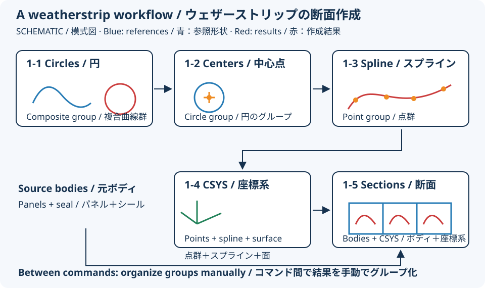

**All group names below are examples**, except that `CLIP_CIRCLE` is also recognized as 1-2's preferred default. The groups are **not automatically passed between journals**.

| Stage | Prepare/select | Result | Manual handoff |
|---|---|---|---|
| 0 — Prepare | Copy of work part; suitable composite curves and panel/seal bodies | A controlled test model | Make `CLIP_COMPOSITES`; optionally classify actual bodies by layer |
| 1-1 — Circles | `CLIP_COMPOSITES` | `HOLE_CIRCLE_…` | Put the desired circle features into `CLIP_CIRCLE` |
| 1-2 — Centers | `CLIP_CIRCLE` | `ARC_CENTER_…` | Put the intended points into `SEAL_POINTS`; check timestamp path order |
| 1-3 — Path | `SEAL_POINTS` with at least four points | `SPLINE_SEAL_POINTS` | Retain that spline; select it explicitly in 1-4 |
| 1-4 — Frames | `SEAL_POINTS` + spline + suitable surface/body feature | `SPLINE_CSYS_…` | Test one first, undo that test, then process all; group final CSYS in `SECTION_CSYS` |
| 1-5 — Sections | `SECTION_BODIES` (panels + seal) and `SECTION_CSYS` | Intersections + new drawing sheet/base views | Compare against manual local sections, update-test, save |

1. **Inspect first:** do the circles represent the intended boundaries, and do their centers trace a sensible path? A center derived from an unsuitable three-point circle can misplace every later station.
2. **Check direction:** point history controls spline traversal; spline tangent and surface normal control CSYS. Correct the upstream geometry, not just the apparent view rotation.
3. **Start small:** after preparing the reference path, use a temporary group containing one or two final CSYS for the first 1-5 acceptance run. Keep source bodies unchanged. Expand only after checking profiles, layers and isolation.
4. **Choose coverage deliberately:** compare square and circle with equal span if corners matter. Default square side 5 mm may omit most of a seal; choose an engineering size for your model.
5. **Approve, then scale up:** perform the [1-5 checklist](#command-15-en), then create the full batch. Save the part/drawing explicitly. Export and downstream adjustments are separate operations.

You may start at a later command if suitable input geometry already exists; the five steps are a useful workflow, not an enforced dependency on running every earlier script.

<a id="tutorial-ja"></a>
## 図解：ウェザーストリップの一連の操作 — 日本語

**想定例：** 自動車ドアの上辺・側辺のウェザーストリップに沿って、比較しやすい局所断面を作成します。円の基準から中心点を定め、スプラインで経路の接線、座標系で安定した局所断面を定義します。有界交線を使い、各ビューにアセンブリ全体の形状を持ち込まないようにします。


**以下のグループ名は例**です。ただし`CLIP_CIRCLE`は1-2の優先既定値としても認識されます。ジャーナル間でのグループの**自動受渡しはありません**。

| 段階 | 準備・選択 | 結果 | 手動で行う次への準備 |
|---|---|---|---|
| 0 — 準備 | 作業パートのコピー、適切な複合曲線とパネル・シールボディ | 管理されたテストモデル | `CLIP_COMPOSITES`を作成。必要なら実ボディを分類レイヤへ配置 |
| 1-1 — 円 | `CLIP_COMPOSITES` | `HOLE_CIRCLE_…` | 必要な円を`CLIP_CIRCLE`へ入れる |
| 1-2 — 中心点 | `CLIP_CIRCLE` | `ARC_CENTER_…` | 必要な点を`SEAL_POINTS`へ入れ、タイムスタンプ順を確認 |
| 1-3 — 経路 | 4点以上の`SEAL_POINTS` | `SPLINE_SEAL_POINTS` | スプラインを保持し、1-4で明示的に選択 |
| 1-4 — 座標系 | `SEAL_POINTS`＋スプライン＋適切な面／ボディのフィーチャ | `SPLINE_CSYS_…` | 1点で試して取り消してから全点処理し、最終結果を`SECTION_CSYS`へ入れる |
| 1-5 — 断面 | パネル＋シールの`SECTION_BODIES`と`SECTION_CSYS` | 交線＋新規図面シート・ベースビュー | 手動の局所断面と比較し、更新試験後に保存 |

1. **先に基準を確認：** 円が必要な境界を表し、中心点が適切な経路に沿っているか確認します。不適切な3点円の中心を使うと、後続の全断面位置がずれる場合があります。
2. **方向を確認：** 点の履歴順がスプラインの向きを決め、接線と面法線が座標系を決めます。図面の見かけの回転だけでなく、上流の形状を修正してください。
3. **小さく始める：** 基準経路の準備後、最初の1-5受入試験には、最終座標系の1〜2点だけを入れた一時グループを使います。元ボディは変更せず、輪郭・レイヤ・分離を確認してから増やします。
4. **範囲を意図して選ぶ：** 四隅の形状が必要なら、同じ幅の正方形と円を比較します。一辺5 mmの既定値ではシールの大部分が入らない場合があります。モデルに適した寸法を選んでください。
5. **確認後に全体へ展開：** [1-5のチェック](#command-15-ja)を行ってから全断面を生成します。パート・図面は明示的に保存します。出力や他CADでの調整は別操作です。

適切な入力形状が既にある場合は途中のコマンドから始められます。5段階は便利な作業の流れであり、必ず全ジャーナルを順に実行しなければならない仕組みではありません。

[Home / ホーム](../README.md) · [Installation / 導入](INSTALLATION.md) · [Command index / 一覧](#command-guide--操作ガイド)
