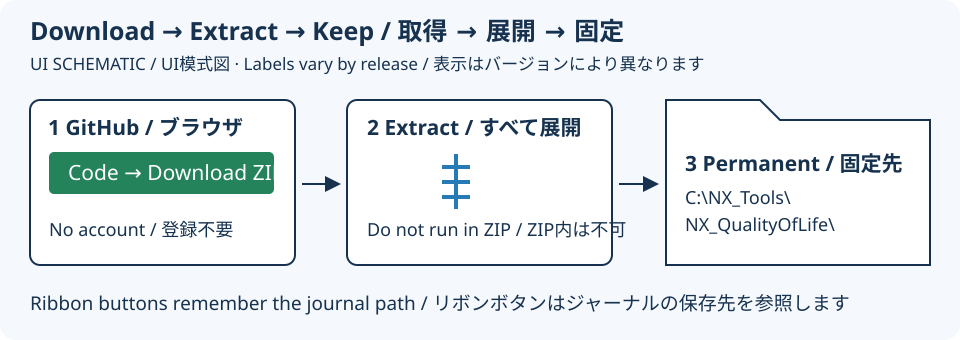
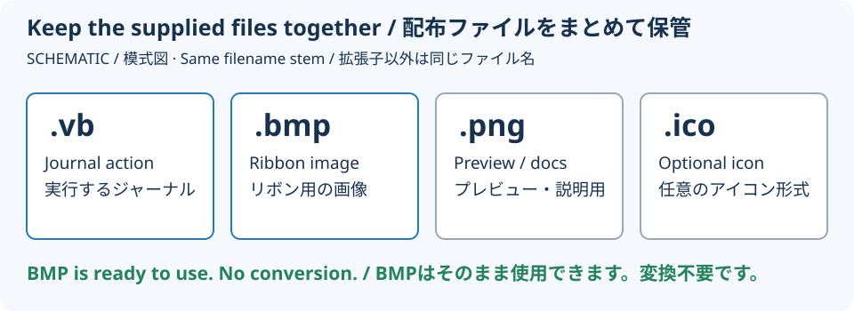
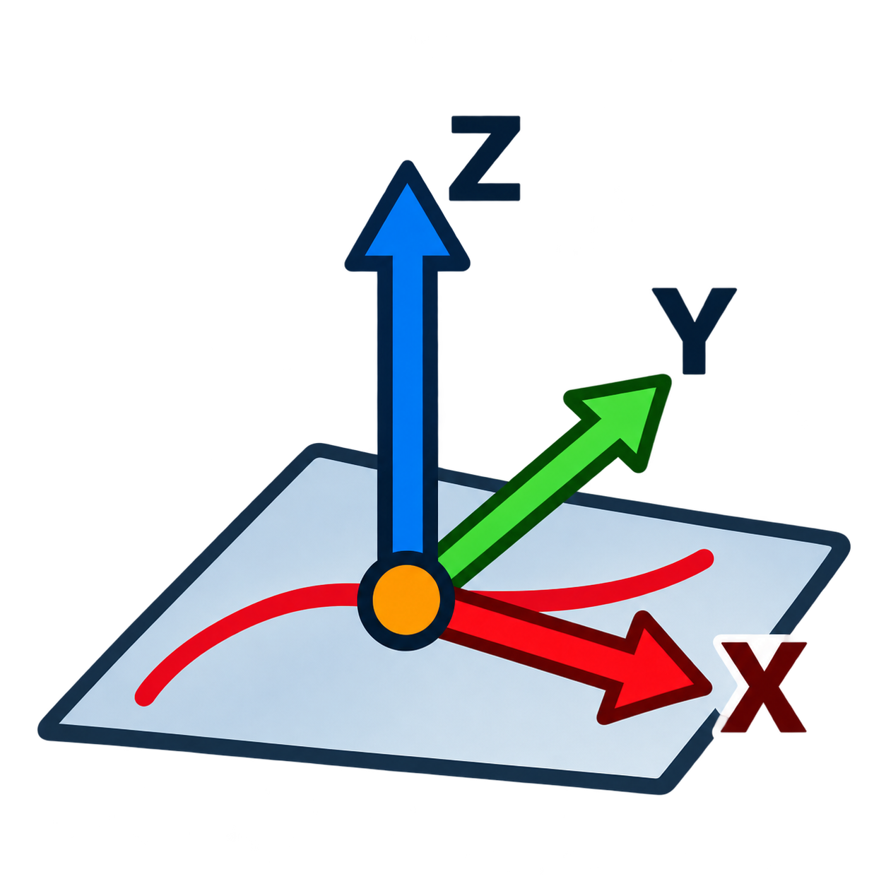
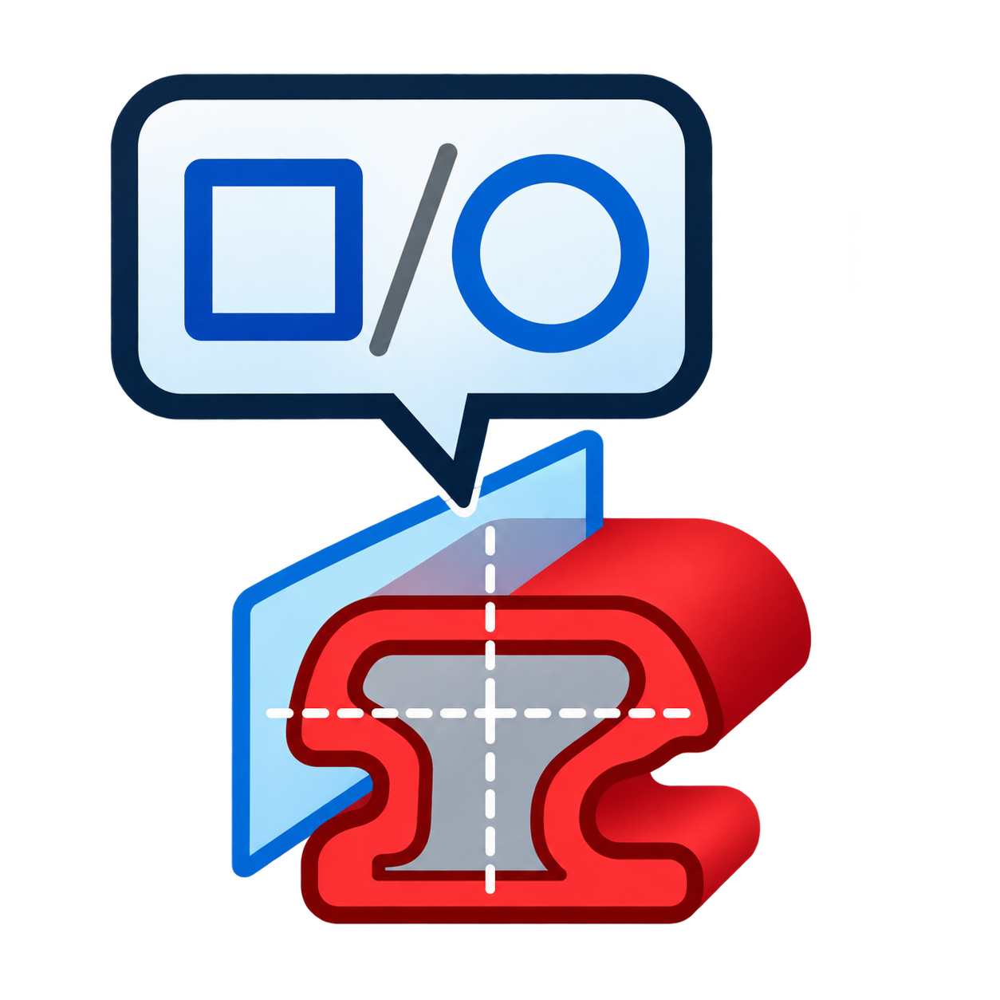
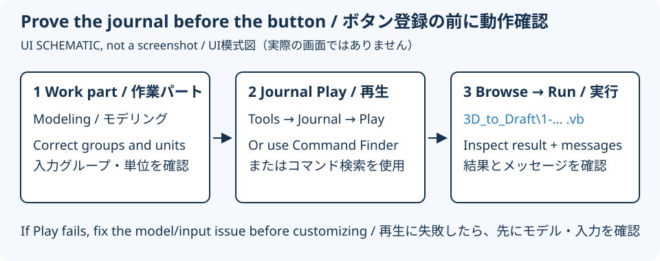
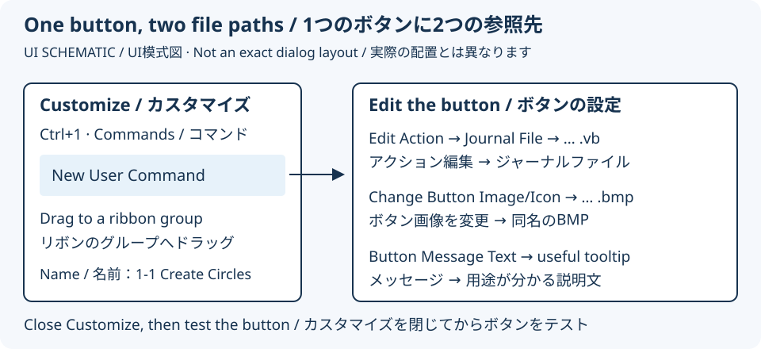
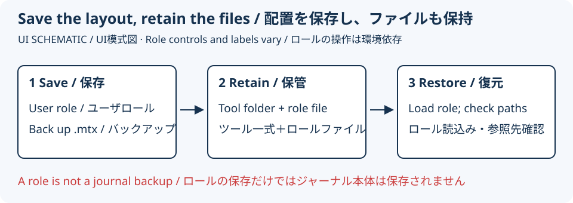

# Installation & ribbon setup / 導入とリボン設定

[Home / ホーム](../README.md) · [Command guide / 操作ガイド](COMMAND_GUIDE.md) · [English](#english) · [日本語](#japanese)

**Read once, then use the five buttons inside NX. / 一度設定すれば、NX内の5つのボタンから実行できます。**

<a id="english"></a>
## English

[A Requirements](#requirements-en) · [B Download](#download-en) · [C Files & icons](#files-en) · [D First run](#first-run-en) · [E Ribbon & roles](#ribbon-en) · [F Troubleshooting](#troubleshooting-en) · [日本語へ](#japanese)

<a id="requirements-en"></a>
### A — Requirements

- A working **Windows Siemens NX installation**, NX Open VB.NET journal execution enabled by your site's policy, and access to the modeling/drafting operations used by these tools. If journal execution is restricted, ask your CAD administrator.
- A suitable **work part** with the required geometry and feature groups. Use **Modeling** for 1-1 to 1-4; their code checks for a work part but does not establish that running them from Drafting is supported. For 1-5, start in **Modeling**, with the **work part also displayed**, in **millimeters**. It switches to Drafting when creating the sheet.
- No separate Python installation, GitHub account, Git installation or standalone compiler is needed.

**Journal versus plugin.** A `.vb` journal is NX Open source that NX compiles and executes when you play it. A plugin is typically a separately built/deployed extension. These five tools use the **journal** workflow: do not double-click the `.vb` in Explorer and do not compile it yourself. Keep NX's installed runtime and libraries intact.

| Command | Evidence in this repository | Compatibility statement |
|---|---|---|
| 1-1, 1-2, 1-3, 1-4 | Source headers identify NX 2306; Windows Forms / NXOpenUI dialogs | Intended baseline, not a live-tested release matrix |
| 1-5 | Source header identifies NX 2406; square/circle intersection and Drafting APIs | Validate on NX 2406 first; do not assume NX 2306 support |
| Optional experimental refresh | Technical notes report NX 2406 compilation | Optional, not a required installation step |

**Verification boundary:** current behavior and defaults were checked against the five production sources. Historical [disk-test notes](../Testing/SealSectionDiskBatchTest.md) report compilation against NX 2406 and successful earlier circular runs, but mix multiple revisions and pending tests. They do **not** certify every current feature. An NX 2406 installation/session was detected during documentation work, but desktop access was unavailable; **no journal execution, screenshots or new NX compatibility tests were performed**. Use a copy of a representative part for acceptance testing.

<a id="download-en"></a>
### B — Download and choose a permanent location



#### Recommended: Download ZIP

1. Open [stefanoKS/NX_QualityOfLife](https://github.com/stefanoKS/NX_QualityOfLife) in a browser. GitHub is the website hosting these files.
2. Above the file list, select **Code**, then **Download ZIP**.
3. In Windows Explorer, right-click the downloaded ZIP and choose **Extract All**. Open the extracted folder; an extra enclosing folder may have been created.
4. Move the folder containing [3D_to_Draft/](../3D_to_Draft/) to a permanent local location, for example:

   ```text
   C:\NX_Tools\NX_QualityOfLife\
       3D_to_Draft\
       docs\
       Testing\       (optional; not used by the five buttons)
   ```

5. Confirm that the actual journal exists at, for example, `C:\NX_Tools\NX_QualityOfLife\3D_to_Draft\1-2_ArcCenterPoints_Associative.vb`.

**Do not run files from inside the ZIP or a temporary Downloads preview.** Ribbon actions refer to file paths, so moving/renaming the folder later breaks those references. Use a location you can read; avoid modifying the NX installation folder. Keep the original ZIP as a version backup if useful.

#### Optional: Git, for developers

If Git is already installed, open a terminal in your chosen parent directory and run:

```console
git clone https://github.com/stefanoKS/NX_QualityOfLife.git
```

This creates an `NX_QualityOfLife` folder. This route is optional; engineers using ZIP do not need to learn Git.

#### Updating without losing your settings

- Back up the current tool folder, any locally edited files and your saved NX role **outside** the folder being replaced. Do not mix your only copies of work parts or personal files with downloaded tools.
- ZIP users: extract the new download into a **separate staging folder**, read the changed instructions, then deliberately replace the tool files in the original stable location. Keep the same folder and journal filenames. Do not delete unknown local files.
- Git users: inspect `git status` first. Preserve local changes before updating; for a clean checkout, `git pull --ff-only` avoids an unexpected merge. If it refuses, resolve the local/diverged state rather than force-resetting.
- After either update, test with **Journal Play**, then test the buttons. If a journal was renamed or moved, update its action path and matching BMP path. An NX role stores the button definition; it does not embed the source files.

<a id="files-en"></a>
### C — Files and the supplied icons



| Extension | Use here |
|---|---|
| `.vb` | Executable NX Open journal source; select this for the button **action** |
| `.bmp` | Ready-to-use image for the custom NX ribbon button |
| `.png` | Icon preview and documentation image |
| `.ico` | Optional icon format; **not needed** for this ribbon workflow |

**The supplied BMP files are ready to use. No PNG-to-ICO conversion, icon generation or replacement icons are required.** The previews below use the original PNG assets; select the matching **BMP** in NX.

#### Exact file pairs / 正確なファイルの対応

All files below are in [3D_to_Draft/](../3D_to_Draft/). The full filenames matter.

| Preview / プレビュー | Journal action / 実行ファイル | Button image / ボタン画像 |
|---|---|---|
|  | [1-1_CirclesFromCompositeGroups.vb](../3D_to_Draft/1-1_CirclesFromCompositeGroups.vb) | [1-1_CirclesFromCompositeGroups.bmp](../3D_to_Draft/1-1_CirclesFromCompositeGroups.bmp) |
|  | [1-2_ArcCenterPoints_Associative.vb](../3D_to_Draft/1-2_ArcCenterPoints_Associative.vb) | [1-2_ArcCenterPoints_Associative.bmp](../3D_to_Draft/1-2_ArcCenterPoints_Associative.bmp) |
|  | [1-3_SplineThroughGroupPoints.vb](../3D_to_Draft/1-3_SplineThroughGroupPoints.vb) | [1-3_SplineThroughGroupPoints.bmp](../3D_to_Draft/1-3_SplineThroughGroupPoints.bmp) |
|  | [1-4_CoordinateSystems_PointSplineSurface.vb](../3D_to_Draft/1-4_CoordinateSystems_PointSplineSurface.vb) | [1-4_CoordinateSystems_PointSplineSurface.bmp](../3D_to_Draft/1-4_CoordinateSystems_PointSplineSurface.bmp) |
|  | [1-5_Drafting.vb](../3D_to_Draft/1-5_Drafting.vb) | [1-5_Drafting.bmp](../3D_to_Draft/1-5_Drafting.bmp) |

<a id="first-run-en"></a>
### D — Run the first journal manually



1. Save a **copy** of a suitable part. Open it in NX **Modeling** and make it the work part. “Work part” is the part receiving the new features; it is not necessarily every component visible in an assembly.
2. For a simple first test, use **1-2** with a uniquely named feature group containing one circle/arc feature directly. Do not use a layer category or an assembly component group in place of a **feature group**.
3. Find **Tools → Journal → Play** (often under **Menu**), or use **Command Finder** to find **Play Journal / Journal Play**. NX 2406 menu resources include Journal → Play and a Tools Journal ribbon group; the displayed route depends on release, role and application.
4. Browse to the required `.vb` in the permanent [3D_to_Draft/](../3D_to_Draft/) folder. Choose **Run/Play** in your release's journal dialog.
5. Select the input group, confirm, then inspect the new `ARC_CENTER_001` point feature and the message. See [1-2 details](COMMAND_GUIDE.md#command-12-en).
6. If it fails, keep the full error text and check [troubleshooting](#troubleshooting-en). If it succeeds, use NX Undo if this was only a test; save the intended model result explicitly when ready.

Testing this way separates a **model/journal problem** from a **button-path problem**. The journals do not save the work part for you.

<a id="ribbon-en"></a>
### E — Create the five ribbon buttons



The following is a **verified workflow pattern**, not an exact reproduction of every NX release. [NX Journaling's illustrated tutorial](https://nxjournaling.com/content/start-journal-custom-button) documents Ctrl+1, New User Command, Edit Action, Journal File, Change Button Image and button message text. Modern ribbon layouts may use **New Item** instead of **New Button**, or **Icon** instead of **Image**. Use NX Help/Command Finder for your installed release; do not choose a different execution type merely because a screenshot from another release differs.

1. Open NX in the application where you want the buttons available, initially **Modeling**.
2. Open **Customize** with **Ctrl+1**, or right-click an empty area of the ribbon and select **Customize**. **Tools → Customize** is another route where exposed.
3. In the ribbon customization controls, create a custom tab named **NX Quality of Life**, and a group inside it, or choose an existing user-editable ribbon group. The tab/group creation controls differ by release; consult the ribbon customization help if they are not shown.
4. In **Commands**, find the category **New Item / New Button**, then **New User Command**.
5. Drag **New User Command** onto your target ribbon group. Keep Customize open while editing it.
6. Right-click the new command and change its **Name/Rename** to the suggested name below. Confirm the name (Enter where required).
7. Right-click it again and choose **Edit Action**.
8. Set the action **Type** to **Journal File** (localized equivalent: ジャーナルファイル).
9. **Browse** to the matching `.vb`, using the full permanent path. For example, the 1-1 action must end in `3D_to_Draft\1-1_CirclesFromCompositeGroups.vb`.
10. Use **Change Button Image / Change Button Icon** on the command's context menu. Browse to its exact matching `.bmp` from the [file-pair table](#files-en), not the `.ico`.
11. Enter useful **Button Message Text / tooltip** describing the input and result, not just “Run”.
12. Accept the action settings, finish/close Customize, then click the new button on the same test part.
13. Repeat for all five. If your role keeps application-specific layouts, make them available in the required application and test there. **1-5 starts in Modeling**, so it does not need a Drafting button to begin.
14. Save the customization/role as described below, restart NX normally when convenient, and verify that the buttons persist.

| Suggested button name | Example tooltip |
|---|---|
| 1-1 Create Circles | Composite Curve group → associative circles |
| 1-2 Arc Centers | Arc/circle group → associative center points |
| 1-3 Create Spline | Ordered point group → open degree-3 spline |
| 1-4 Create CSYS | Points + spline + surface → Datum CSYS; first-point test initially |
| 1-5 Batch Sections | Millimeter work part: bodies + CSYS → local sections and drawing |

#### Retain the layout and back up your role



- Close the customization dialog to apply the layout. Where available, enable **Save Layout at Exit** under **Preferences → User Interface → Layout**, and close NX normally so user settings are written. Older and newer releases may place this option differently.
- Use the **Roles** tools (Roles resource bar or User Interface/role controls, depending on release) to **create/save a user role** containing the customized layout; **New Role** commonly saves a `.mtx` file. Use your release's Help for the exact save/export controls. Keep a backup of that role and a note of the permanent tool path.
- After switching roles, select/load your saved custom role again. If buttons are not visible, also check the active application and whether the custom tab is enabled.
- A role backup **does not contain the `.vb` or `.bmp` files**. Another computer needs both those files at the expected path and the role/button definitions.
- Site-managed roles, read-only profiles or login scripts may replace personal layouts. Ask your CAD administrator rather than overwriting system role files. Test persistence after a normal NX restart.

**Remove a button:** open Customize, right-click the custom command and choose its remove/delete customization action (or drag it off the ribbon if supported). This removes the UI item only; leave the journal and icon files on disk. Save the revised role/layout.

<a id="troubleshooting-en"></a>
### F — Troubleshooting

| Symptom | Check / action |
|---|---|
| Button does nothing | Close Customize first. Check that the action type is **Journal File**, then try the same file with Journal Play. Read any journal error dialog/Listing Window; confirm site policy permits journals. |
| Journal file not found | In Edit Action, browse to the actual `.vb`; check for an extra ZIP wrapper folder, spelling, and a disconnected network path. |
| Icon is absent | Re-select the corresponding supplied **BMP** with Change Button Image/Icon; check that it was extracted and has not moved. A PNG preview is not the selected action file. |
| Folder was moved | Either restore the original location or correct **both** the journal and BMP paths for every affected button. |
| No work part / wrong part | Open the intended part and make it the work part. 1-5 also requires that same part to be displayed. Work on a backup, not the wrong assembly component. |
| Wrong units | Confirm part units. 1-5 rejects inch parts; it does not convert them. 1-1 has unit-specific endpoint tolerances; 1-2 to 1-4 have no explicit millimeter-only check. Test those on your units rather than assuming release/unit certification. |
| No groups / missing geometry | Create a **feature group** in the work part. For 1-1 to 1-4 put the actual source features directly in it; nested traversal is implemented for 1-5 only. Use unique names for 1-1 to 1-3. Check suppression and input object types. |
| Journal execution/compilation failure | Record the NX release, journal filename, full error and failed step. Test with Journal Play and a small supported input. Ask your CAD administrator about NX Open/runtime/policy compatibility; do not randomly edit the source or install unrelated Python packages. |
| Partial or unexpected model result | Inspect the message and Undo history. 1-1 may skip individual composites; other failures generally attempt rollback. If rollback fails, use NX Undo or reopen your saved copy. Do not save an unexplained partial result over the original. |
| Incomplete or mixed 1-5 views | Compare with a manual section, check curve layers, update the views and read the [optional refresh/regeneration guidance](COMMAND_GUIDE.md#updates-en). A success message does not prove complete profiles. |
| Buttons disappear / settings changed | Restore the saved user role, enable the tab, check the current application, and exit NX normally. If settings still do not persist, check profile write access/site-managed settings with your administrator. Do not delete your entire NX user profile as a first step. |

[Continue to the command guide](COMMAND_GUIDE.md#preparation-en) · [日本語](#japanese) · [Home](../README.md)

---

<a id="japanese"></a>
## 日本語

[A 必要環境](#requirements-ja) · [B ダウンロード](#download-ja) · [C ファイルと画像](#files-ja) · [D 初回実行](#first-run-ja) · [E リボンとロール](#ribbon-ja) · [F トラブル対処](#troubleshooting-ja) · [English](#english)

<a id="requirements-ja"></a>
### A — 必要な環境

- 正常に動作する**Windows版Siemens NX**が必要です。社内ポリシーでNX OpenのVB.NETジャーナルの実行が許可され、使用するモデリング・ドラフティング機能を利用できることを確認してください。実行が制限されている場合はCAD管理者に相談してください。
- 必要な形状とフィーチャグループを含む**作業パート**を用意します。1-1〜1-4は**モデリング**で使用してください。作業パートの有無はコードで確認していますが、ドラフティングからの実行に対応することまでは確認されていません。1-5は**ミリメートル単位**で、**作業パートと表示パートを一致**させ、**モデリング**から開始します。図面作成時に自動でドラフティングへ移ります。
- Python、GitHubアカウント、Git、単独のコンパイラを別途用意する必要はありません。

**ジャーナルとプラグインの違い：** `.vb`ジャーナルは、再生時にNXがコンパイルして実行するNX Openのソースファイルです。プラグインは通常、あらかじめビルドして配置する拡張機能です。この5つのツールは**ジャーナル方式**なので、エクスプローラで`.vb`をダブルクリックしたり、ご自身でコンパイルしたりする必要はありません。NX付属のランタイムやライブラリは変更しないでください。

| コマンド | リポジトリ内の根拠 | 互換性について |
|---|---|---|
| 1-1、1-2、1-3、1-4 | ソース冒頭にNX 2306と記載。Windows Forms / NXOpenUIのダイアログを使用 | 想定環境の記載であり、実機検証済みバージョン一覧ではありません |
| 1-5 | ソース冒頭にNX 2406と記載。正方形・円の交線とドラフティングAPIを使用 | まずNX 2406で確認してください。NX 2306対応とは断定できません |
| 任意の実験用表示更新ツール | 技術資料にNX 2406でのコンパイル報告あり | 導入に必須ではありません |

**検証の範囲：** 現行の動作・既定値を、5つの本体ソースと照合しています。[過去の円形断面テスト資料](../Testing/SealSectionDiskBatchTest.md)にはNX 2406でのコンパイルや以前の円形処理の成功報告がありますが、複数の改訂と未検証事項が混在しています。現行の全機能の動作証明ではありません。今回の文書作成時にNX 2406のインストールと起動は確認できましたが、デスクトップ操作が利用できず、**ジャーナル実行・画面撮影・新たなNX互換性試験は行っていません**。代表的なパートのコピーで受入確認を行ってください。

<a id="download-ja"></a>
### B — ダウンロードして保存先を固定する


#### 推奨：Download ZIP

1. ブラウザで[stefanoKS/NX_QualityOfLife](https://github.com/stefanoKS/NX_QualityOfLife)を開きます。GitHubは、このツールのファイルを公開しているWebサイトです。
2. ファイル一覧の上にある **Code → Download ZIP** を選択します。
3. WindowsのエクスプローラでZIPを右クリックし、**すべて展開**します。展開したフォルダを開きます。外側にもう1つフォルダが作成される場合があります。
4. [3D_to_Draft/](../3D_to_Draft/)を含むフォルダを、変更しないローカル保存先へ移します。例：

   ```text
   C:\NX_Tools\NX_QualityOfLife\
       3D_to_Draft\
       docs\
       Testing\       (任意。5つのボタンでは使用しません)
   ```

5. 例として、`C:\NX_Tools\NX_QualityOfLife\3D_to_Draft\1-2_ArcCenterPoints_Associative.vb`が実際に存在することを確認します。

**ZIP内やダウンロードの一時プレビューからは実行しないでください。** リボンのアクションは保存先のパスを参照するため、後でフォルダを移動・改名すると参照が切れます。読取り可能な場所を使用し、NXのインストールフォルダは変更しないでください。必要に応じて元のZIPを版のバックアップとして保管します。

#### 任意：開発者向けのGit

Gitが既にインストールされている場合は、保存先の親フォルダでターミナルを開き、次を実行できます。

```console
git clone https://github.com/stefanoKS/NX_QualityOfLife.git
```

`NX_QualityOfLife`フォルダが作成されます。この方法は任意です。ZIPを使うエンジニアがGitを学ぶ必要はありません。

#### 設定やローカルファイルを失わずに更新する

- 現在のツールフォルダ、ローカルで編集したファイル、保存済みNXロールを、**更新先の外側**へバックアップします。作業パートや個人ファイルの唯一のコピーを、配布ツールと混在させないでください。
- ZIPの場合：新しいZIPを**別の確認用フォルダ**へ展開し、変更された説明を読んでから、元の固定場所にあるツールファイルを確認して置き換えます。フォルダ名とジャーナル名は維持してください。用途不明のローカルファイルは削除しないでください。
- Gitの場合：まず`git status`で状態を確認し、ローカル変更を保全します。変更のない状態なら`git pull --ff-only`で意図しないマージを避けて更新できます。拒否された場合は状態を確認して解決し、強制リセットで上書きしないでください。
- 更新後は**ジャーナル再生**とボタンの両方をテストします。ファイルが移動・改名された場合は、アクションと対応BMPの参照先を修正します。NXロールに保存されるのはボタンの定義であり、ソース本体ではありません。

<a id="files-ja"></a>
### C — ファイルと配布アイコン


| 拡張子 | この導入方法での用途 |
|---|---|
| `.vb` | NX Openの実行用ソース。ボタンの**アクション**として選択 |
| `.bmp` | NXのカスタムリボンボタンにそのまま使える画像 |
| `.png` | アイコンのプレビュー・ドキュメント表示用 |
| `.ico` | 任意のアイコン形式。このリボン設定では**不要** |

**配布済みのBMPはそのまま使用できます。PNGからICOへの変換、アイコン生成、代替アイコンの作成は不要です。** [正確な対応表と5つのプレビュー](#files-en)を参照してください。表のプレビューは元のPNGですが、NXの画像設定には対応する**BMP**を選びます。すべて[3D_to_Draft/](../3D_to_Draft/)に入っています。省略せず、完全に一致する名前を選んでください。

<a id="first-run-ja"></a>
### D — 最初にジャーナルを手動で再生する


1. 適切なパートの**コピー**を保存します。NXの**モデリング**で開き、作業パートに設定します。作業パートは新しいフィーチャの作成先であり、アセンブリで表示されている全コンポーネントを意味するものではありません。
2. 最初の簡単なテストには、円または円弧のフィーチャを直下に1つ含み、一意の名前を付けたフィーチャグループで**1-2**を使用します。レイヤカテゴリやアセンブリのコンポーネントグループとは異なります。
3. **ツール → ジャーナル → 再生**を探します（**メニュー**内にある場合があります）。見つからなければ**コマンド検索**でジャーナルの再生を検索してください。NX 2406のメニュー定義にはJournal → PlayとToolsのJournalリボングループがありますが、実際の表示経路はバージョン・ロール・アプリケーションによります。
4. 固定保存先の[3D_to_Draft/](../3D_to_Draft/)から該当の`.vb`を参照し、お使いの再生ダイアログの**実行／再生**を選びます。
5. 入力グループを選んで確定し、新しい`ARC_CENTER_001`点フィーチャとメッセージを確認します。[1-2の詳細](COMMAND_GUIDE.md#command-12-ja)も参照してください。
6. 失敗した場合はエラー全文を残し、[トラブル対処](#troubleshooting-ja)を確認します。テストだけならNXの「元に戻す」で結果を取り消してください。必要な結果を残す場合は、明示的にパートを保存します。

この手順で、**モデル・ジャーナルの問題**と**ボタンの参照先の問題**を切り分けられます。ジャーナルは作業パートを自動保存しません。

<a id="ribbon-ja"></a>
### E — 5つのリボンボタンを作成する


以下は**資料と照合した操作の流れ**であり、全NXバージョンの画面を完全に再現したものではありません。[NX Journalingの図解記事](https://nxjournaling.com/content/start-journal-custom-button)で、Ctrl+1、New User Command、Edit Action、Journal File、Change Button Image、メッセージの設定を確認できます。新しいリボンUIでは、**New Button**が**New Item**、**Image**が**Icon**などの表記になる場合があります。お使いのNXのヘルプ・コマンド検索で確認し、他バージョンの画像と異なるという理由だけで実行形式を変えないでください。

1. NXを開き、まず**モデリング**でボタンを設定します。
2. **Ctrl+1**、またはリボンの空白部分の右クリックから**カスタマイズ（Customize）**を開きます。表示される環境では**ツール → カスタマイズ**からも開けます。
3. リボンのカスタマイズ機能で **NX Quality of Life** タブと、その中のグループを作成するか、既存の編集可能なリボングループを選びます。作成用の操作部品はバージョン依存です。見つからない場合はリボンのカスタマイズのヘルプを確認してください。
4. **コマンド（Commands）**で **New Item / New Button** カテゴリにある **New User Command** を探します。
5. **New User Command**を目的のリボングループへドラッグします。設定中はカスタマイズ画面を開いたままにします。
6. 新しいコマンドを右クリックし、**名前／名前の変更（Name/Rename）**で下表の名前を設定します。必要に応じてEnterで確定します。
7. 再度右クリックし、**アクション編集（Edit Action）**を開きます。
8. **種類（Type）**を**ジャーナルファイル（Journal File）**にします。
9. **参照（Browse）**で、固定保存先の対応する`.vb`を選びます。例：1-1のパス末尾は`3D_to_Draft\1-1_CirclesFromCompositeGroups.vb`です。
10. コマンドの右クリックメニューの**ボタン画像／アイコンの変更（Change Button Image / Change Button Icon）**で、[対応表](#files-en)と同じ`.bmp`を選びます。`.ico`ではありません。
11. **ボタンメッセージ（Button Message Text）／ツールチップ**に、入力と結果が分かる説明を設定します。「実行」だけでなく用途を記載してください。
12. アクション設定を確定し、カスタマイズを終了してから、同じテスト用パートでボタンを押します。
13. 5つ分繰り返します。アプリケーションごとに配置を保持するロールでは、必要なアプリケーションで表示・動作を確認してください。**1-5もモデリングから開始**するため、開始用にドラフティング側のボタンを用意する必要はありません。
14. 下記の方法で配置・ロールを保存し、都合のよいときにNXを通常終了・再起動して、設定が残ることを確認します。

| 推奨ボタン名 | ツールチップの例 |
|---|---|
| 1-1 Create Circles | 複合曲線グループから関連付け円を作成 |
| 1-2 Arc Centers | 円弧・円のグループから関連付け中心点を作成 |
| 1-3 Create Spline | 順序付けされた点群から非閉鎖の3次スプラインを作成 |
| 1-4 Create CSYS | 点群＋スプライン＋面からデータム座標系を作成。既定で全点を処理。Y・X反転とX・Z反転を組み合わせ可能 |
| 1-5 Batch Sections | ミリメートル単位の作業パート：ボディ＋座標系から局所断面と図面を作成 |

#### 配置の保持とロールのバックアップ


- カスタマイズ画面を閉じて配置を適用します。設定がある場合は、**基本設定 → ユーザインタフェース → レイアウト**の**終了時にレイアウトを保存（Save Layout at Exit）**を有効にし、NXを通常終了して個人設定を書き込みます。設定場所はバージョンにより異なります。
- **ロール（Roles）**の機能で、現在のカスタマイズを含む**ユーザロールを作成・保存**します。ロールのリソースバーまたはユーザインタフェース設定などに配置されます。**New Role**では通常`.mtx`を保存します。正確な保存・書出し操作は、お使いのバージョンのヘルプで確認してください。ロールのバックアップとツールの固定パスを保管します。
- 別のロールに切り替えてボタンが消えた場合は、保存したロールを再選択・読込みします。現在のアプリケーションと、カスタムタブの表示設定も確認してください。
- ロールのバックアップには**`.vb`や`.bmp`本体は含まれません**。別のPCでは、想定パスに置いたファイル本体とロール・ボタン設定の両方が必要です。
- 社内管理ロール、読取り専用プロファイル、ログインスクリプトが個人設定を置き換える場合があります。システムのロールファイルを上書きせず、CAD管理者に相談してください。NXの通常再起動後に設定が残るか確認します。

**ボタンの削除：** カスタマイズを開き、対象のカスタムコマンドを右クリックして削除・除去します。対応している環境ではリボン外へドラッグする方法もあります。削除するのはUI上の項目だけです。ディスク上のジャーナルと画像は削除せず、変更後の配置・ロールを保存してください。

<a id="troubleshooting-ja"></a>
### F — トラブル対処

| 症状 | 確認・対処 |
|---|---|
| ボタンを押しても動かない | カスタマイズを閉じ、種類が**Journal File**か確認します。同じファイルをジャーナル再生で試し、エラー画面・情報ウィンドウと、社内の実行許可を確認してください。 |
| ジャーナルが見つからない | アクション編集で実際の`.vb`を参照し直します。ZIPの外側フォルダの重複、綴り、ネットワーク接続を確認します。 |
| アイコンが表示されない | 配布済みの同名**BMP**を選び直し、展開済みで移動していないか確認します。PNGプレビューは実行ファイルではありません。 |
| 保存フォルダを移動した | 元の場所に戻すか、影響する全ボタンについてジャーナルとBMPの**両方**のパスを修正します。 |
| 作業パートがない・違う | 対象パートを開いて作業パートに設定します。1-5は表示パートも同じにします。誤ったコンポーネントではなく、対象のバックアップで作業してください。 |
| 単位が違う | パート単位を確認します。1-5はインチパートを拒否し、自動変換しません。1-1は単位別の端点接続許容差を使用します。1-2〜1-4にミリメートル限定チェックはありませんが、全単位・全バージョンでの検証を意味しません。実際の単位で確認してください。 |
| グループや元形状が見つからない | 作業パート内に**フィーチャグループ**を作成します。1-1〜1-4は元のフィーチャを直下に置きます。入れ子を再帰的に調べるのは1-5だけです。1-1〜1-3は名前を一意にし、抑制状態と入力型を確認します。 |
| 実行・コンパイルエラー | NXの版、ファイル名、エラー全文、失敗した手順を記録します。小さい適切な入力で再生を試し、NX Open・ランタイム・ポリシーをCAD管理者に確認します。根拠なくソースを編集したり、無関係なPythonパッケージを入れたりしないでください。 |
| 結果が部分的・不明な形状になった | メッセージと元に戻す履歴を確認します。1-1は複合曲線ごとにスキップする場合があります。他の失敗では通常ロールバックを試みます。取消しに失敗した場合はNXの「元に戻す」か保存済みコピーを使用し、不明な結果を元データに上書き保存しないでください。 |
| 1-5のビューが欠ける・混在する | 手動断面と比較し、曲線レイヤ・ビュー更新を確認します。[任意の表示更新と再生成](COMMAND_GUIDE.md#updates-ja)も参照してください。成功メッセージだけでは輪郭の完全性は証明できません。 |
| ボタンが消えた・設定が戻る | 保存済みロール、タブ表示、現在のアプリケーションを確認し、NXを通常終了します。改善しなければ、プロファイルの書込み権限や社内管理設定を管理者に確認してください。最初の対処としてNXの個人設定フォルダ全体を削除しないでください。 |

[操作ガイドへ](COMMAND_GUIDE.md#preparation-ja) · [English](#english) · [ホーム](../README.md)
